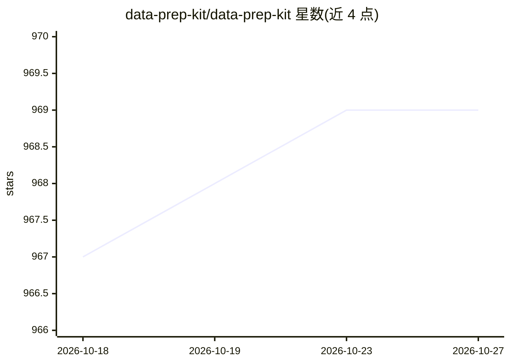

# data-prep-kit/data-prep-kit

⭐ 969 · HTML · Apache-2.0 · 推送 2026-09-29 · [GitHub](https://github.com/data-prep-kit/data-prep-kit) · [官网](https://data-prep-kit.github.io/data-prep-kit/) · 组织维护

**面向 LLM 应用的非结构化数据预处理框架（清洗/转换/丰富）**

为 LLM 应用开发者提供的非结构化数据预处理工具集：以模块化 transform 组成数据管道，支持自然语言、代码、图像三种模态，覆盖去重、质量标注、PII 脱敏、分词、RAG 分块等 40 余种转换。基于 Python 与 Ray 运行时，可从笔记本扩展到数据中心与 Kubernetes 集群部署。面向预训练、微调、指令微调与 RAG 构建场景，由 IBM Research 起源，现为 LF AI & Data 基金会托管项目。

## 筛选速览

| 维度 | 判定 | 备注 |
|---|---|---|
| AI 角色 | `ai-ecosystem` | LLM/agent 周边工具 |
| 许可风险 | `permissive` | Apache-2.0 |
| 部署形态 | `library` | 以包/库形式分发 |
| 模型依赖 | — | README 未给出锁定关系 |
| 硬件要求 | — | 无带数字的原话,不猜 |
| 安装摩擦 | `low` | 无编译、无系统依赖或容器化 |
| 成熟度 | — | 结构信号不足 |

## 能力要点

- 40 余种 transform 覆盖语言/代码/图像三模态（去重、质量标注、PII 脱敏等）
- Python 与 Ray 双运行时，支持笔记本到数据中心规模扩展
- transform 可组合成管道并部署到 Kubernetes（Python/Ray job、Tekton 流水线）
- 提供企业用例 recipe 与 Google Colab 快速体验 notebook

## 适用场景

- 为 LLM 预训练/微调准备和清洗语料
- 构建 RAG 应用前对文档做分块与质量过滤
- 对大规模数据集做去重与 PII 脱敏处理

## 场景标签

`微调` `模型训练` · 领域:训练与推理

## 证据(README 行号)

> L11: Data-Prep-Kit accelerates unstructured data preparation for LLM app developers. Developers can use Data-Prep-Kit to
> L19: - The modules are built on common frameworks for Python and Ray runtimes for scaling up data processing.

## 星数曲线

2026-10-18 967 → 2026-10-27 969（+2）

---
*卡片 v1 · prompt 1.4 · 生成 2026-10-21 · 置信度 high · 依据 README sha `ae95044e4aff` · [字段定义](../../DATASET.md)*
