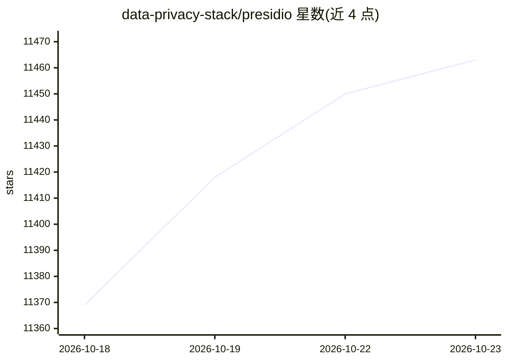

# data-privacy-stack/presidio

⭐ 11,463 · Python · MIT · 推送 2026-10-19 · [GitHub](https://github.com/data-privacy-stack/presidio) · [官网](https://presidio.dataprivacystack.org) · 组织维护

**文本与图像中敏感数据（PII）的检测、脱敏与匿名化 SDK**

开源的 PII 数据保护与去标识化框架，提供识别（Analyzer）与匿名化（Anonymizer）模块，可识别文本中的信用卡号、姓名、位置、社保号、比特币钱包等实体；识别器基于命名实体识别、正则、规则逻辑与校验和，支持多语言与自定义，可连接外部 PII 检测模型。另有图像脱敏模块（含 DICOM 医学图像）与结构化数据处理组件。可通过 Python/PySpark、Docker 或 Kubernetes 使用。README 声明自动检测不保证找出全部敏感信息，需配合其他系统。

## 筛选速览

| 维度 | 判定 | 备注 |
|---|---|---|
| AI 角色 | `ai-native` | 本体是模型或模型工具 |
| 许可风险 | `permissive` | MIT |
| 部署形态 | `library` | 以包/库形式分发 |
| 模型依赖 | — | README 未给出锁定关系 |
| 硬件要求 | — | 无带数字的原话,不猜 |
| 安装摩擦 | `low` | 无编译、无系统依赖或容器化 |
| 成熟度 | — | 结构信号不足 |

## 能力要点

- 基于 NER、正则、规则与校验和的预置/自定义 PII 识别器
- 图像脱敏模块，支持标准图像与 DICOM 医学图像
- Python/PySpark、Docker、Kubernetes 多种运行方式
- Analyzer / Anonymizer / Image-Redactor / Structured 四个组件

## 适用场景

- 对客服记录、文档等文本做 PII 检测与脱敏后再交付或分析
- 对含隐私信息的图片（含医疗影像）做遮盖处理
- 在 PySpark 或 Kubernetes 环境中部署自动化去标识化流程

## 场景标签

`图像视频处理` · 领域:感知与多模态

## 证据(README 行号)

> L20: Presidio _(Origin from Latin praesidium ‘protection, garrison’)_ helps to ensure sensitive data is properly managed
> L42: 1. **Predefined** or **custom PII recognizers** leveraging _Named Entity Recognition_, _regular expressions_, _rule

## 星数曲线

2026-10-18 11,369 → 2026-10-23 11,463（+94）

---
*卡片 v1 · prompt 1.4 · 生成 2026-10-20 · 置信度 high · 依据 README sha `09dc6b91d877` · [字段定义](../../DATASET.md)*
