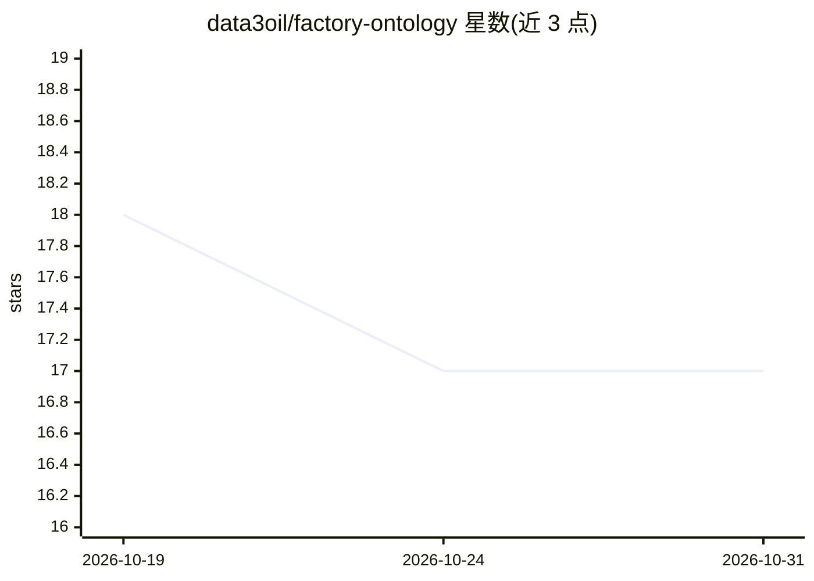

# data3oil/factory-ontology

⭐ 17 · Python · Apache-2.0 · 推送 2026-10-28 · [GitHub](https://github.com/data3oil/factory-ontology) · 组织维护 · 中文 README

**把工厂台账 CSV 变成带证据溯源的自然语言问答系统**

面向没有专职数据团队的中小工厂的本体驱动数据问答框架：把 CSV/JSON/SQLite/Excel/MySQL/PostgreSQL 台账通过 schema 建模成'实体-关系-属性'知识图谱（N-Triples），业务人员用自然语言问数据。检索为确定性优先的降级链：规则引擎（零 token）→ 逻辑推理桥 → 本体引导 GraphRAG → BM25+本地向量混合检索 → LLM 兜底，每个回答附证据溯源。数据本地流转不上云，支持 DeepSeek/Ollama 模型配置；换行业只换 schema 与词典。限定台账级结构化数据，不处理非结构化文本，能力边界在结构化查询模板内。由三油科技（data3oil）开源，仓库定位为可被闭源侧编排的'算法原子层'。

## 筛选速览

| 维度 | 判定 | 备注 |
|---|---|---|
| AI 角色 | `ai-native` | 本体是模型或模型工具 |
| 许可风险 | `permissive` | Apache-2.0 |
| 部署形态 | `self-host` | docker 或自建部署 |
| 模型依赖 | local-ok | 支持本地模型 |
| 硬件要求 | — | 无带数字的原话,不猜 |
| 安装摩擦 | `low` | 无编译、无系统依赖或容器化 |
| 成熟度 | — | 结构信号不足 |

## 能力要点

- 规则引擎确定性优先，答案带证据、零 token、可复现
- 本体引导 GraphRAG + BM25/本地向量 RRF 混合检索的降级链
- schema/词典/字段映射全外置，换工厂换行业只换配置
- 本体自演进人在环：候选进待确认区，确认/回退均留审计痕迹

## 适用场景

- 业务人员不写 SQL，直接问'报警的空压机有几台'这类数据问题
- 把 MES/ERP/台账数据建成可问答的知识图谱且数据不出厂
- 老师傅经验以词典和本体形式留存，新人自然语言查数据

## 场景标签

`知识图谱` `RAG` `数据分析` · 领域:效率与自动化

## 证据(README 行号)

> L6: **工厂本体驱动的数据问答框架。** 把结构化台账变成可自然语言提问的语义知识图谱，CSV 进，答案出，每个答案都带证据。
> L91: 本方案取第三条路。本体把表变成受限 schema，规则引擎在 schema 内确定性回答：数量、极值、平均、过滤、范围、计数。答案精确、可复现、零 token。规则覆盖不到的开放式问题，降级到本体引导的 GraphRAG 和 LL
> L263: 分层：交付层（Web/APP/语音/管理后台）→ API 层（FastAPI，原子对外暴露的编排入口）→ 原子层（本体认知原子：建模 + 确定性规则问答；rag 原子：GraphRAG + 混合检索；事件原子：数据事件模型）→ 

## 星数曲线

2026-10-19 18 → 2026-10-31 17（-1）

---
*卡片 v1 · prompt 1.4 · 生成 2026-10-30 · 置信度 mid · 依据 README sha `d0b6970b0a03` · [字段定义](../../DATASET.md)*
