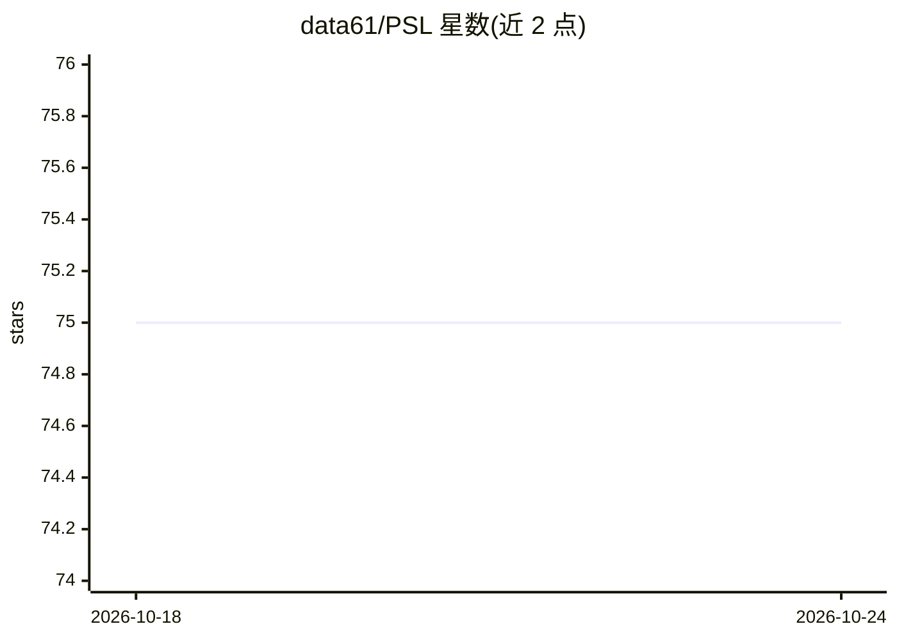

# data61/PSL

⭐ 75 · Isabelle · NOASSERTION · 推送 2026-08-09 · [GitHub](https://github.com/data61/PSL) · 组织维护

**Isabelle/HOL 定理证明的 AI 辅助证明搜索与策略语言工具集**

面向 Isabelle/HOL 交互式定理证明的工具集，实现证明策略语言 PSL、默认策略 try_hard、SeLFiE、sem_ind 以及可在证明中途调用的 AbductionProver（suggest 仅打印建议证明脚本，solve 直接闭合目标）。工具在 Isabelle/jEdit 内运行，通过 imports 导入使用；并给出云/VM 上显式设置 threads、按内存限制 Sledgehammer 并发与外部证明器内存上限等运行细节。README 声明为开发版本，LiFtEr、Smart_Induct 与 PaMpeR 已不再支持。

## 筛选速览

| 维度 | 判定 | 备注 |
|---|---|---|
| AI 角色 | `ai-native` | 本体是模型或模型工具 |
| 许可风险 | `none` | NOASSERTION |
| 部署形态 | `None` |  |
| 模型依赖 | — | README 未给出锁定关系 |
| 硬件要求 | — | 无带数字的原话,不猜 |
| 安装摩擦 | `low` | 无编译、无系统依赖或容器化 |
| 成熟度 | `idea` | |

## 能力要点

- PSL 证明策略语言与默认策略 try_hard
- AbductionProver 的 suggest/solve 可在结构化证明中途调用
- 提供 Sledgehammer 并发与外部证明器内存（cgroup）限制机制
- 配套学术论文（CADE2017/CICM2018/ASE2018）

## 适用场景

- 在 Isabelle/HOL 中自动搜索并生成归纳证明脚本
- 证明中途对当前子目标求建议脚本或自动闭合
- 在内存受限或云虚拟机上调整证明搜索的资源占用

## 场景标签

 · 领域:形式化方法/交互式定理证明

## 证据(README 行号)

> L11: This repository contains various tools to support interactive theorem proving in Isabelle/HOL using artificial inte
> L12: This repository contains the implementation of *proof strategy language (PSL)* and its default strategy,

## 星数曲线

2026-10-18 75 → 2026-10-24 75（+0）

---
*卡片 v1 · prompt 1.4 · 生成 2026-10-24 · 置信度 high · 依据 README sha `4cbd832949fd` · [字段定义](../../DATASET.md)*
