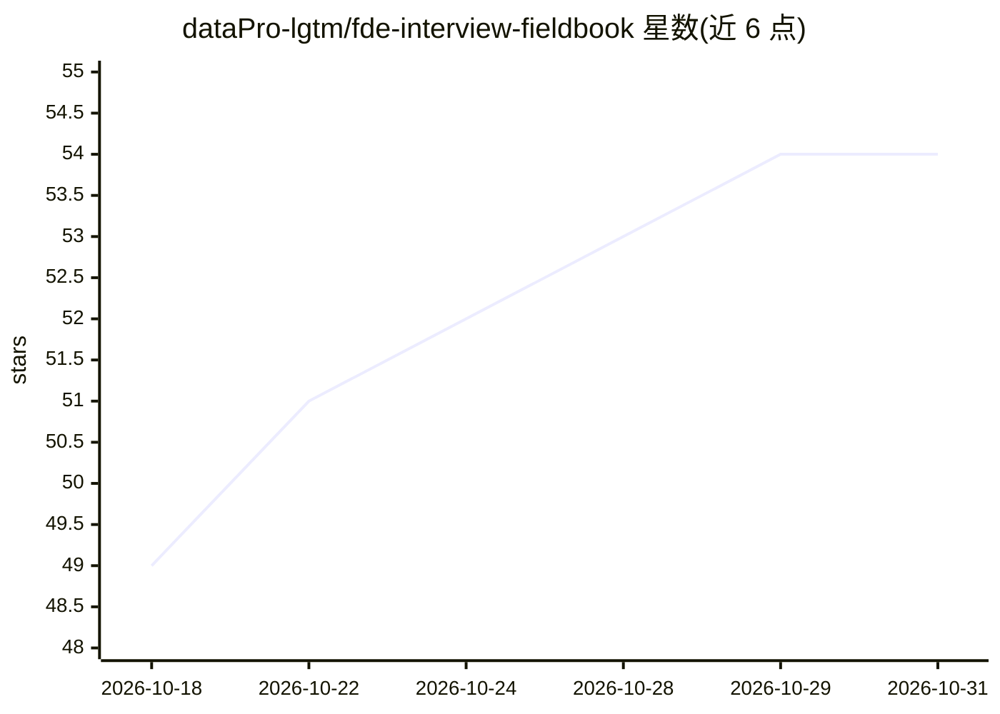

# dataPro-lgtm/fde-interview-fieldbook

⭐ 54 · Python · MIT · 推送 2026-08-22 · [GitHub](https://github.com/dataPro-lgtm/fde-interview-fieldbook) · 个人维护 · 中文 README

**面向求职者的 FDE（前向部署工程师）面试实战手册**

一份双语（简体中文/英文）、以来源支撑为原则的 FDE 面试准备手册：覆盖 FDE 角色图谱、FIELD 推理循环（Frame/Inspect/Engineer/Launch/Distill）、生产 AI 主题（RAG、agents、MCP、A2A、evals、可观测性、安全等）、十个带分阶段证据的实战案例包、多套评分卡与 7/14/30 天引导练习路径。时效性声明记录来源与 last_checked 日期，按 Official/Corroborated/Community 三级置信标签标注，并提供 python3 scripts/verify_release.py 做可复现审计。当前版本 1.0.0-rc.1，MIT 许可，声明与任何雇主无隶属关系。

## 筛选速览

| 维度 | 判定 | 备注 |
|---|---|---|
| AI 角色 | `ai-knowledge` | 知识聚合/清单类 |
| 许可风险 | `permissive` | MIT |
| 部署形态 | `None` |  |
| 模型依赖 | — | README 未给出锁定关系 |
| 硬件要求 | — | 无带数字的原话,不猜 |
| 安装摩擦 | `low` | 无编译、无系统依赖或容器化 |
| 成熟度 | `idea` | |

## 能力要点

- FIELD 五步推理循环贯穿案例面试、系统设计与生产事故
- 十个生产案例包，含分阶段证据、角色分离简报与案例专属评分标准
- 来源与时效性契约：sources.json、last_checked 日期与三级置信标签
- 提供 verify_release.py 可复现本地审计脚本

## 适用场景

- 系统准备 FDE 岗位面试，按 60 分钟到 30 天的分档路径练习
- 用盲评案例与评分卡进行模拟面试与校准
- 把目标岗位 JD 转化为基于证据的求职行动方案

## 场景标签

`教程课程` · 领域:学习与行业

## 证据(README 行号)

> L3: > A source-backed, production-first field guide for Forward Deployed Engineer interviews.
> L14: - a practical interview operating system rather than a leaked-question dump;
> L15: - production AI coverage: RAG, agents, context engineering, MCP, A2A, evals, observability, durable execution, secu

## 星数曲线

2026-10-18 49 → 2026-10-31 54（+5）

---
*卡片 v1 · prompt 1.4 · 生成 2026-10-24 · 置信度 high · 依据 README sha `d6ebe735ee09` · [字段定义](../../DATASET.md)*
