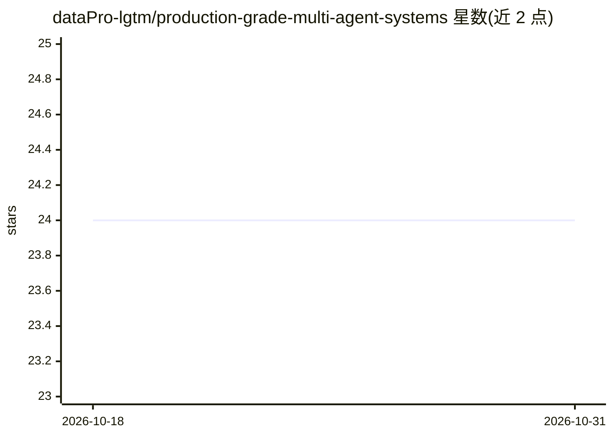

# dataPro-lgtm/production-grade-multi-agent-systems

⭐ 24 · JavaScript · CC-BY-4.0 · 推送 2026-07-28 · [GitHub](https://github.com/dataPro-lgtm/production-grade-multi-agent-systems) · [官网](https://datapro-lgtm.github.io/production-grade-multi-agent-systems/) · 个人维护 · 中文 README

**面向 AI 工程师的生产级多智能体系统中文开源书**

一本简体中文为内容源、附英文和日文完整翻译的开源书（CC BY 4.0），围绕“哪部分真的需要 Agent 自主决策”组织十章内容，覆盖工具调用与 MCP、多 Agent 协作、上下文工程、生产部署、安全、系统合龙、评测、AgentOps 与可验证交付。配套独立参考实现 CaseOps（分仓维护），本仓库另提供 68 张架构图与 10 份工程模板。本地阅读需 Python 3.10+ 并以 MkDocs 构建。

## 筛选速览

| 维度 | 判定 | 备注 |
|---|---|---|
| AI 角色 | `ai-knowledge` | 知识聚合/清单类 |
| 许可风险 | `viral` | CC-BY-4.0 |
| 部署形态 | `library` | 以包/库形式分发 |
| 模型依赖 | — | README 未给出锁定关系 |
| 硬件要求 | — | 无带数字的原话,不猜 |
| 安装摩擦 | `low` | 无编译、无系统依赖或容器化 |
| 成熟度 | — | 结构信号不足 |

## 能力要点

- 十章覆盖架构判断、工具调用、多 Agent 协作、评测与 AgentOps
- 配套参考实现 CaseOps（v1.0.0 含 SBOM、Release Evidence、非 root 容器）
- 68 张原创架构图与 10 份工程模板
- 简体中文/英文/日文三语版本并通过同步校验

## 适用场景

- AI 工程师系统学习多 Agent 系统的生产化设计
- 架构评审时复用生产就绪与安全评审契约等模板
- 技术团队按章节对照搭建自己的 Agent 交付流程

## 场景标签

`教程课程` · 领域:学习与行业

## 证据(README 行号)

> L10: 一本面向 AI 工程师、架构师、平台与安全团队、技术负责人的开源书，提供简体中文、英文和日文三个完整版本。
> L12: 本书从一个基础判断出发：系统中的哪一部分，真的需要根据环境反馈自主决定下一步？围绕这个问题，十章依次讨论受控工具调用、多 Agent 协作、上下文工程、生产基础设施、安全、系统合龙、评测、AgentOps 和可验证交付。

## 星数曲线

2026-10-18 24 → 2026-10-31 24（+0）

---
*卡片 v1 · prompt 1.4 · 生成 2026-10-27 · 置信度 mid · 依据 README sha `da1d559dd149` · [字段定义](../../DATASET.md)*
