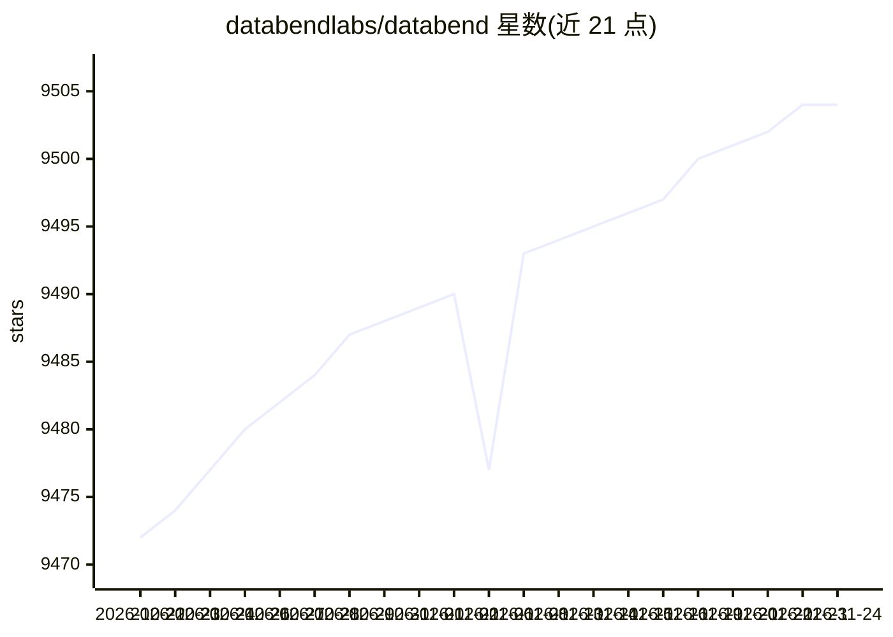

# databendlabs/databend

⭐ 9,505 · Rust · Apache-2.0 · 推送 2026-11-24 · [GitHub](https://github.com/databendlabs/databend) · [官网](https://docs.databend.com) · 组织维护

**面向企业与 Agent 的统一数据仓库：SQL 分析、向量与全文检索一体**

用 Rust 构建的开源数据仓库，运行在 S3/Azure/GCS 等对象存储上，在同一套表上提供 SQL 分析、向量检索、全文检索、自动 schema 演进、事务与 Git 式数据分支。面向需要将分析、搜索与 AI Agent 工作负载放在同一系统的企业与开发者。Agent 相关机制为沙箱化 Python UDF：三层架构（控制面调度、Databend 执行 SQL 编排、沙箱 Worker 隔离运行 Agent 逻辑）。提供云服务与自托管 Docker 镜像两种方式。许可为 Apache 2.0，少量企业功能为 Elastic 2.0。

## 筛选速览

| 维度 | 判定 | 备注 |
|---|---|---|
| AI 角色 | `ai-enhanced` | 去掉 AI 部分产品仍成立 |
| 许可风险 | `permissive` | Apache-2.0 |
| 部署形态 | `self-host` | docker 或自建部署 |
| 模型依赖 | — | README 未给出锁定关系 |
| 硬件要求 | — | 无带数字的原话,不猜 |
| 安装摩擦 | `low` | 无编译、无系统依赖或容器化 |
| 成熟度 | — | 结构信号不足 |

## 能力要点

- SQL 分析、向量检索、全文检索在单一仓库内完成
- 沙箱化 Python UDF 运行 Agent 逻辑，经 Arrow Flight 请求计算
- Git 式数据分支，可在生产快照上安全实验
- 自托管 all-in-one Docker 镜像与 BendSQL 客户端连接

## 适用场景

- 为 AI Agent 提供沙箱 UDF 加 SQL 编排的数据底座
- 大规模 SQL 分析与 BI 报表
- 基于向量与全文检索构建搜索与 RAG 服务
- 在对象存储上构建弹性扩展的云原生数仓

## 场景标签

`向量数据库` · 领域:知识与检索

## 证据(README 行号)

> L4:  SQL analytics, vector search, and full-text search in a single Rust warehouse on object storage: fast, elastic, and
> L20: Databend is an open-source data warehouse built in Rust. Analytics, search, and agent workloads run on the same tab
> L24: |**📊 One Warehouse** SQL analytics, vector search, full-text search, auto schema evolution, transactions.|**🤖 Agent

## 星数曲线

2026-10-22 9,472 → 2026-11-24 9,504（+32）

---
*卡片 v1 · prompt 1.4 · 生成 2026-11-23 · 置信度 high · 依据 README sha `f7b114342503` · [字段定义](../../DATASET.md)*
