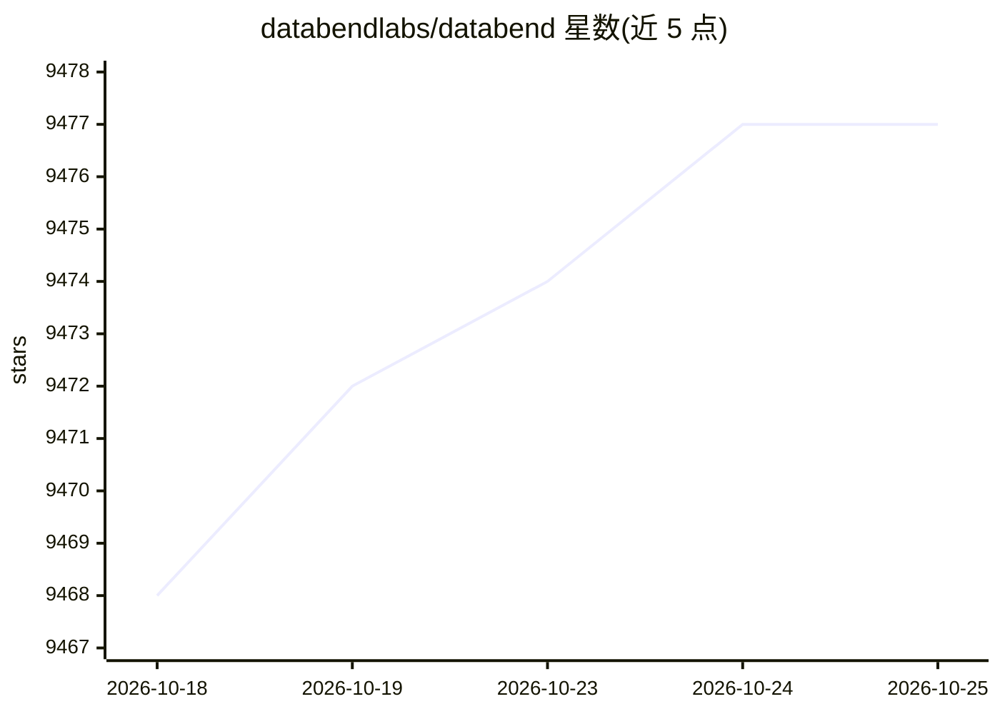

# databendlabs/databend

⭐ 9,477 · Rust · Apache-2.0 · 推送 2026-10-24 · [GitHub](https://github.com/databendlabs/databend) · [官网](https://docs.databend.com) · 组织维护

**Rust 编写的云原生企业数据仓库，支持分析与 AI Agent 工作负载**

开源企业级数据仓库，用 Rust 构建，面向大规模分析、向量搜索、全文搜索与自动 schema 演进，统一在单一引擎中。面向运行 AI 工作负载的企业：提供沙箱 Python UDF 供 agent 逻辑执行、SQL 编排、事务与类 Git 数据分支以在生产快照上安全实验。存储支持 S3/Azure/GCS，计算弹性伸缩。许可为 Apache 2.0，少量企业功能采用 Elastic 2.0。可通过 pip 本地模式或 Docker 运行。

## 筛选速览

| 维度 | 判定 | 备注 |
|---|---|---|
| AI 角色 | `ai-enhanced` | 去掉 AI 部分产品仍成立 |
| 许可风险 | `permissive` | Apache-2.0 |
| 部署形态 | `self-host` | docker 或自建部署 |
| 模型依赖 | — | README 未给出锁定关系 |
| 硬件要求 | — | 无带数字的原话,不猜 |
| 安装摩擦 | `low` | 无编译、无系统依赖或容器化 |
| 成熟度 | — | 结构信号不足 |

## 能力要点

- 分析、向量搜索、全文搜索统一在单一引擎
- 三层沙箱 UDF 架构（控制面/执行面/计算面）运行 agent 逻辑
- 类 Git 数据分支，agent 可在生产快照上安全操作
- 存储支持 S3/Azure/GCS，弹性云原生计算

## 适用场景

- 大规模 SQL 分析与 BI 场景
- 在仓库内构建向量+全文搜索支撑 RAG
- 以沙箱 UDF 与 SQL 编排运行数据上的 AI agent
- 对生产数据做分支式安全实验

## 场景标签

 · 领域:数据库/数据分析

## 证据(README 行号)

> L19: Databend is an open-source enterprise data warehouse built in Rust.

## 星数曲线

2026-10-18 9,468 → 2026-10-25 9,477（+9）

---
*卡片 v1 · prompt 1.4 · 生成 2026-10-20 · 置信度 high · 依据 README sha `a5e709b777c6` · [字段定义](../../DATASET.md)*
