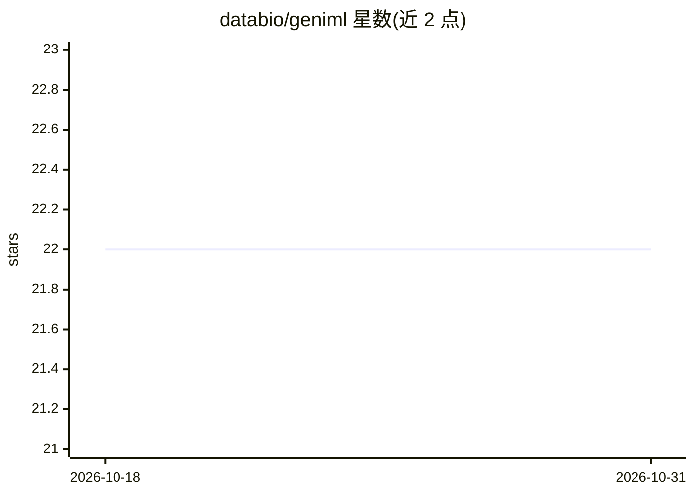

# databio/geniml

⭐ 22 · Python · BSD-2-Clause · 推送 2026-10-28 · [GitHub](https://github.com/databio/geniml) · [官网](https://docs.bedbase.org/geniml/) · 组织维护

**基因组区间数据（BED 文件）机器学习建模的 Python 包**

databio 实验室维护的 Python 包，用于对基因组区间数据（BED 文件）构建机器学习模型，并附带支持其他类型区间分析的辅助函数。默认 pip 安装不包含机器学习和重型处理依赖，需通过 pip install geniml[ml] 额外安装 ML 依赖；也可从 GitHub 源码安装。文档托管在 docs.bedbase.org。

## 筛选速览

| 维度 | 判定 | 备注 |
|---|---|---|
| AI 角色 | `ai-native` | 本体是模型或模型工具 |
| 许可风险 | `permissive` | BSD-2-Clause |
| 部署形态 | `library` | 以包/库形式分发 |
| 模型依赖 | — | README 未给出锁定关系 |
| 硬件要求 | — | 无带数字的原话,不猜 |
| 安装摩擦 | `low` | 无编译、无系统依赖或容器化 |
| 成熟度 | — | 结构信号不足 |

## 能力要点

- 对 BED 基因组区间文件构建机器学习模型
- 提供区间数据其他分析的辅助函数
- ML 依赖按需安装（geniml[ml]）

## 适用场景

- 对基因组区间（BED）数据做表示学习与预测建模
- 对基因组区间数据执行配套辅助分析

## 场景标签

`数据分析` · 领域:效率与自动化

## 证据(README 行号)

> L1: # Genomic interval machine learning (geniml)
> L3: Geniml is a python package for building machine learning models of genomic interval data (BED files). It also includ

## 星数曲线

2026-10-18 22 → 2026-10-31 22（+0）

---
*卡片 v1 · prompt 1.4 · 生成 2026-10-27 · 置信度 high · 依据 README sha `0e5225a9e6f4` · [字段定义](../../DATASET.md)*
