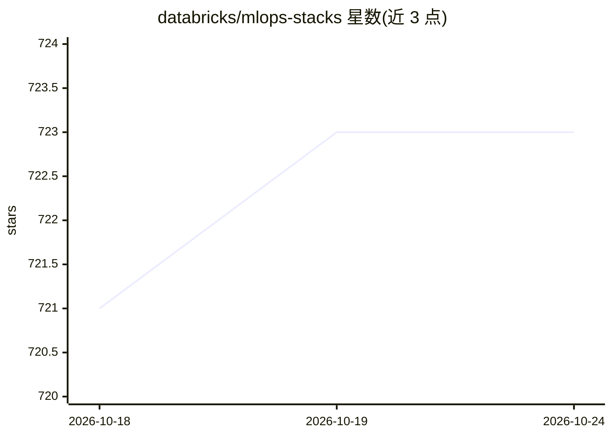

# databricks/mlops-stacks

⭐ 723 · Go Template · Apache-2.0 · 推送 2026-10-20 · [GitHub](https://github.com/databricks/mlops-stacks) · [官网](https://docs.databricks.com/en/dev-tools/bundles/mlops-stacks.html) · 组织维护

**Databricks 上的 MLOps 项目模板栈：快速生成带 CI/CD 的 ML 工程**

基于 Databricks CLI asset bundle 模板的项目生成器，通过 databricks bundle init mlops-stacks 初始化包含三个模块的 ML 项目：带单元测试的 ML 代码结构（训练与批量推理）、以 databricks CLI bundles 定义的 ML 资源即代码、以及 GitHub Actions 或 Azure DevOps 的 CI/CD 工作流。面向在 Databricks 平台上开发 ML 项目的数据科学家与 ML 工程师，覆盖 dev/staging/prod 三环境的开发-验证-部署流程，支持 AWS/Azure/GCP。功能处于 public preview。

## 筛选速览

| 维度 | 判定 | 备注 |
|---|---|---|
| AI 角色 | `ai-ecosystem` | LLM/agent 周边工具 |
| 许可风险 | `permissive` | Apache-2.0 |
| 部署形态 | `library` | 以包/库形式分发 |
| 模型依赖 | — | README 未给出锁定关系 |
| 硬件要求 | — | 无带数字的原话,不猜 |
| 安装摩擦 | `low` | 无编译、无系统依赖或容器化 |
| 成熟度 | `idea` | |

## 能力要点

- 一条命令初始化含 ML 代码、资源即代码与 CI/CD 的完整项目栈
- 支持 GitHub Actions、Azure DevOps 与 GitLab 作为 CI/CD 平台
- 可选 Databricks Feature Store 组件与 Unity Catalog 模型注册
- dev/staging/prod 三环境部署流程与 PR 触发的自动化测试

## 适用场景

- 在 Databricks 上开箱启动符合生产实践的新 ML 项目
- 为已有 ML 项目补装 CI/CD 或资源即代码组件
- 自动化批量创建预配置 CI/CD 的数据科学项目

## 场景标签

`MLOps` · 领域:训练与推理

## 证据(README 行号)

> L5: This repo provides a customizable stack for starting new ML projects
> L8: Using Databricks MLOps Stacks, data scientists can quickly get started iterating on ML code for new projects while o
> L62:  databricks bundle init mlops-stacks

## 星数曲线

2026-10-18 721 → 2026-10-24 723（+2）

---
*卡片 v1 · prompt 1.4 · 生成 2026-10-21 · 置信度 mid · 依据 README sha `77906511c9d0` · [字段定义](../../DATASET.md)*
