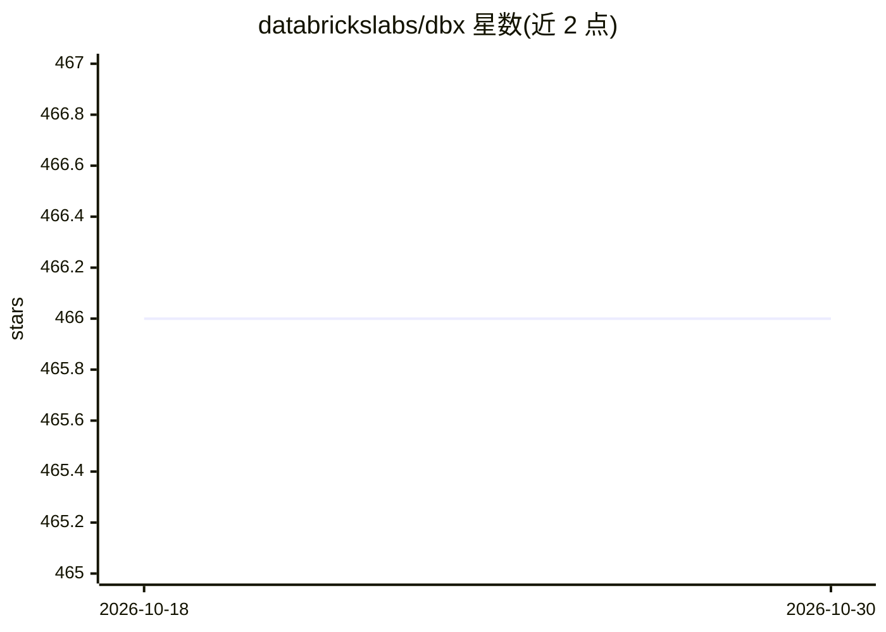

# databrickslabs/dbx

⭐ 466 · Python · NOASSERTION · 推送 2026-03-27 · [GitHub](https://github.com/databrickslabs/dbx) · [官网](https://dbx.readthedocs.io) · 组织维护

**Databricks 工作流开发与部署的 CLI 工具（已停止维护）**

dbx 是 Databricks Labs 推出的命令行工具，用于在多环境间简化 Databricks 工作流的开发、部署与启动，并支持以带版本的方式打包项目并投递到 Databricks 环境；按 CLI-first 设计，可嵌入 CI/CD 流水线或作为本地快速原型工具。要求 Python>3.8，通过 pip 安装。README 明确声明项目不再积极维护，建议迁移至 Databricks Asset Bundles。CLI 接口遵循 SemVer，API 组件暂不遵循。

## 筛选速览

| 维度 | 判定 | 备注 |
|---|---|---|
| AI 角色 | `ai-ecosystem` | LLM/agent 周边工具 |
| 许可风险 | `none` | NOASSERTION |
| 部署形态 | `library` | 以包/库形式分发 |
| 模型依赖 | — | README 未给出锁定关系 |
| 硬件要求 | — | 无带数字的原话,不猜 |
| 安装摩擦 | `low` | 无编译、无系统依赖或容器化 |
| 成熟度 | — | 结构信号不足 |

## 能力要点

- 跨多环境管理 Databricks 工作流的开发、部署与启动
- 项目打包与带版本投递到 Databricks 环境
- CLI-first 设计，支持嵌入 CI/CD 流水线与本地原型
- CLI 接口采用 SemVer 版本策略

## 适用场景

- 在 CI/CD 流水线中部署 Databricks 工作流
- 本地快速原型并打包项目投递到 Databricks 环境

## 场景标签

`MLOps` · 领域:训练与推理

## 证据(README 行号)

> L15:  🧱Databricks CLI eXtensions - aka <code>dbx</code> is a CLI tool for development and advanced Databricks workflows 
> L37: `dbx` simplifies Databricks workflows development, deployment and launch across multiple

## 星数曲线

2026-10-18 466 → 2026-10-30 466（+0）

---
*卡片 v1 · prompt 1.4 · 生成 2026-10-21 · 置信度 high · 依据 README sha `63f08d523475` · [字段定义](../../DATASET.md)*
