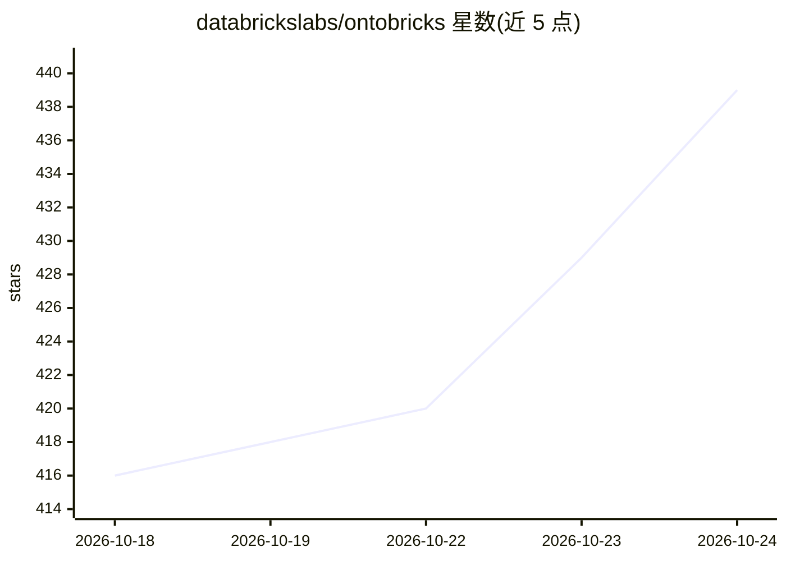

# databrickslabs/ontobricks

⭐ 439 · Python · NOASSERTION · 推送 2026-10-23 · [GitHub](https://github.com/databrickslabs/ontobricks) · 组织维护

**把 Databricks 表转成知识图谱并通过 MCP 发布给 AI agent 的应用**

部署为 Databricks App 的知识图谱工具：从 Unity Catalog 导入元数据，用 LLM 生成本体、SQL 映射并物化三元组，底层基于 OWL、R2RML、SPARQL 并以 Spark SQL 执行。支持可视化本体设计（OntoViz）、OWL 2 RL 推理、SWRL 规则、SHACL 校验、GraphQL API，以及把领域知识通过 MCP 暴露给 Cursor、Claude Desktop 等 LLM 客户端。图引擎按域可选 Lakebase/Neo4j/Lakehouse。需要 Databricks 工作区、SQL Warehouse、Lakebase 与 Unity Catalog Volume。

## 筛选速览

| 维度 | 判定 | 备注 |
|---|---|---|
| AI 角色 | `ai-ecosystem` | LLM/agent 周边工具 |
| 许可风险 | `none` | NOASSERTION |
| 部署形态 | `library` | 以包/库形式分发 |
| 模型依赖 | — | README 未给出锁定关系 |
| 硬件要求 | — | 无带数字的原话,不猜 |
| 安装摩擦 | `low` | 无编译、无系统依赖或容器化 |
| 成熟度 | — | 结构信号不足 |

## 能力要点

- LLM 驱动四步流水线：元数据导入→本体生成→自动映射→图物化
- 通过 MCP 向 Cursor/Claude Desktop 等 AI agent 发布领域知识与工具
- OWL 2 RL 推理、SWRL 规则、SHACL 校验与自动生成 GraphQL API
- 域级 DRAFT/IN-REVIEW/PUBLISHED 生命周期治理与单编辑者锁

## 适用场景

- 把 Lakehouse 中的表组织成可查询、可推理的知识图谱
- 让 LLM agent 基于受治理的业务语义进行推理
- 在 Databricks 内完成本体设计、映射与图谱发布的全流程

## 场景标签

`知识图谱` · 领域:知识与检索

## 证据(README 行号)

> L25: **OntoBricks closes that gap.** It is a Databricks-native app that turns Unity
> L41: - **Built for the AI era.** Publish any domain to LLM agents over the Model

## 星数曲线

2026-10-18 416 → 2026-10-24 439（+23）

---
*卡片 v1 · prompt 1.4 · 生成 2026-10-21 · 置信度 mid · 依据 README sha `d062a5d46631` · [字段定义](../../DATASET.md)*
