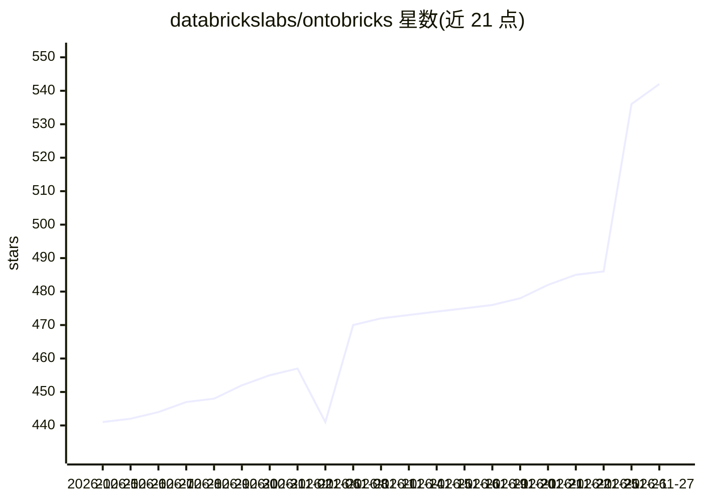

# databrickslabs/ontobricks

⭐ 542 · Python · NOASSERTION · 推送 2026-11-26 · [GitHub](https://github.com/databrickslabs/ontobricks) · 组织维护

**把 Databricks Unity Catalog 表转成知识图谱并以 MCP 提供给 AI agent**

以 Databricks App 形式部署的企业知识图谱工具：从 Unity Catalog 导入表元数据，经本体设计（可视化画布、AI 向导或导入 OWL/FIBO/CDISC 等标准）、LLM 自动生成 R2RML SQL 映射、增量物化三元组四个步骤构建图谱，支持 OWL 2 RL 推理、SWRL 规则与 SHACL 校验、SPARQL/GraphQL 查询与可视化探索，并通过 MCP 向 Cursor、Claude Desktop 等发布图谱工具。提供 No LLM 严格退出模式，此时确定性推理与校验仍可用；域有版本与评审生命周期管理。

## 筛选速览

| 维度 | 判定 | 备注 |
|---|---|---|
| AI 角色 | `ai-enhanced` | 去掉 AI 部分产品仍成立 |
| 许可风险 | `none` | NOASSERTION |
| 部署形态 | `library` | 以包/库形式分发 |
| 模型依赖 | — | README 未给出锁定关系 |
| 硬件要求 | — | 无带数字的原话,不猜 |
| 安装摩擦 | `low` | 无编译、无系统依赖或容器化 |
| 成熟度 | — | 结构信号不足 |

## 能力要点

- 四步流程（导入元数据→生成本体→自动映射→同步）构建知识图谱，另有手动全程工作流
- 以 MCP 发布域工具，可按域配置暴露内容，含仅本体域
- OWL 2 RL 推理、SWRL 规则、SHACL 校验与 Louvain 等社区发现
- 可插拔图引擎：Lakebase/Lakehouse/Neo4j/无后端，按域选择

## 适用场景

- 把 Lakehouse 业务表建成可探索、可查询的知识图谱
- 让 LLM agent 通过 MCP 查询有治理的业务语义
- 导入并定制 FIBO、HL7 FHIR 等行业标准本体
- 对实体执行 SHACL 数据质量检查与业务规则

## 场景标签

`知识图谱` · 领域:知识与检索

## 证据(README 行号)

> L117: Selecting **No LLM** is a strict domain-level opt-out. LLM actions remain
> L161: ### Publish to AI agents (MCP)

## 星数曲线

2026-10-25 441 → 2026-11-27 542（+101）

---
*卡片 v1 · prompt 1.4 · 生成 2026-11-25 · 置信度 mid · 依据 README sha `ad7a5cf870cd` · [字段定义](../../DATASET.md)*
