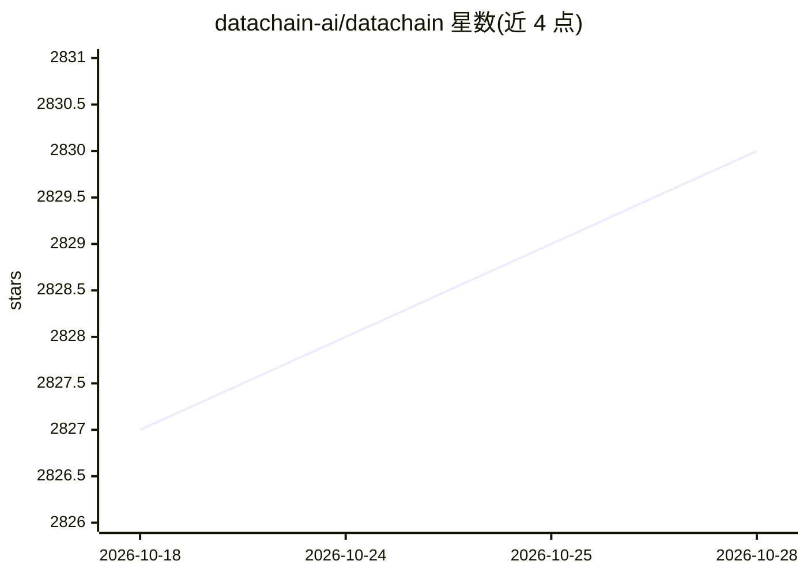

# datachain-ai/datachain

⭐ 2,830 · Python · Apache-2.0 · 推送 2026-10-27 · [GitHub](https://github.com/datachain-ai/datachain) · [官网](https://docs.datachain.ai) · 组织维护

**把 S3/GCS/Azure 文件变成版本化类型化数据集的 Python 库**

面向数据工程师与 AI agent 开发者的数据处理库：将对象存储中的文件索引为带 Pydantic schema 的版本化数据集，数据不复制，只存元数据与文件指针；提供并行计算引擎、检查点恢复、增量更新、向量化查询与向量检索。附带的 agent skill 可将 Knowledge Base（markdown 数据目录）接入 Claude Code、Cursor、Codex 等编码 agent，使其理解数据集结构。Studio 云服务提供团队共享、分布式计算与 MCP 端点。本地以 pip 安装，元数据存于 SQLite。

## 筛选速览

| 维度 | 判定 | 备注 |
|---|---|---|
| AI 角色 | `ai-ecosystem` | LLM/agent 周边工具 |
| 许可风险 | `permissive` | Apache-2.0 |
| 部署形态 | `library` | 以包/库形式分发 |
| 模型依赖 | — | README 未给出锁定关系 |
| 硬件要求 | — | 无带数字的原话,不猜 |
| 安装摩擦 | `low` | 无编译、无系统依赖或容器化 |
| 成熟度 | — | 结构信号不足 |

## 能力要点

- S3/GCS/Azure/本地文件索引为版本化类型化数据集，数据不搬移
- 检查点恢复与增量更新：崩溃后从断点续跑，仅处理新增文件
- Dataset DB 内置向量检索与亚秒级过滤/join/group_by
- Agent skill 生成 dc-knowledge/ 目录供 Claude Code、Cursor、Codex 等 agent 读取

## 适用场景

- 对数千万级文件做带检查点与增量更新的嵌入/标注流水线
- 让 Claude Code 等 agent 读取数据集 schema 并生成处理管道
- 在元数据层做向量相似度检索与结构化过滤的组合查询

## 场景标签

`MLOps` · 领域:训练与推理

## 证据(README 行号)

> L9: **A Python library that turns files in S3, GCS, and Azure into versioned, typed datasets, queryable at warehouse spe
> L17: - **Agent Harness**: a skill that plugs all three into Claude Code, Cursor, Codex, GitHub Copilot, and Pi, so they 
> L80: Code harnesses (Claude Code, Cursor, Codex, GitHub Copilot, Pi) give agents repo context, dedicated tools, and memo

## 星数曲线

2026-10-18 2,827 → 2026-10-28 2,830（+3）

---
*卡片 v1 · prompt 1.4 · 生成 2026-10-21 · 置信度 high · 依据 README sha `62663180157d` · [字段定义](../../DATASET.md)*
