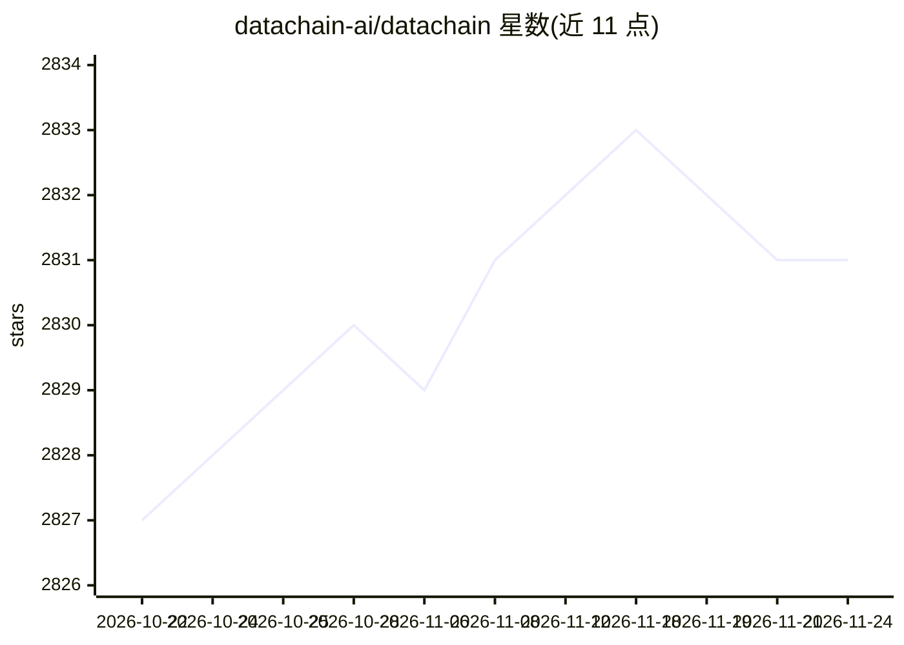

# datachain-ai/datachain

⭐ 2,832 · Python · Apache-2.0 · 推送 2026-11-24 · [GitHub](https://github.com/datachain-ai/datachain) · [官网](https://docs.datachain.ai) · 组织维护

**面向开发者的非结构化数据处理库：跨云文件构建类型化版本化数据集**

Python 库，用于处理 S3/GCS/Azure/本地存储中的大规模文件集合，支持对图像、视频、音频和传感器记录运行读取器与模型，并将结果保存为类型化、版本化的数据集。内置并行 worker、下载重叠与断点续跑机制，支持 delta 更新复用已有结果；元数据查询可基于标签、嵌入构建新训练选择而无需重跑处理。可安装 skill 供编码代理（Claude Code/Codex 等）在项目目录中检查保存结果并续接工作。Apache-2.0，本地使用无需账号或服务器。

## 筛选速览

| 维度 | 判定 | 备注 |
|---|---|---|
| AI 角色 | `ai-native` | 本体是模型或模型工具 |
| 许可风险 | `permissive` | Apache-2.0 |
| 部署形态 | `library` | 以包/库形式分发 |
| 模型依赖 | — | README 未给出锁定关系 |
| 硬件要求 | — | 无带数字的原话,不猜 |
| 安装摩擦 | `low` | 无编译、无系统依赖或容器化 |
| 成熟度 | — | 结构信号不足 |

## 能力要点

- 对图像/视频/音频/传感器文件运行读取器与模型，保存为类型化版本化数据集
- delta 更新仅处理变更文件并复用已保存结果
- LeRobot episodes、MCAP 时间窗口、WebDataset 样本共用同一 Python API
- 提供 skill 使编码代理可检查保存结果并在新会话续接工作

## 适用场景

- 从机器人演示录制中筛选并整理训练数据
- 调查模型失败案例、发现数据覆盖缺口
- 在读取内容前用存储元数据盘点百万级对象
- 将已保存的数据选择导出到 PyTorch 等训练工具

## 场景标签

 · 领域:数据基础设施/MLOps

## 证据(README 行号)

> L7: DataChain is a Python library for processing large file collections in S3, GCS, Azure and local storage.
> L8: Run your readers and models over images, video, audio and sensor recordings, then save the results as typed, version

## 星数曲线

2026-10-22 2,827 → 2026-11-24 2,831（+4）

---
*卡片 v1 · prompt 1.4 · 生成 2026-11-23 · 置信度 high · 依据 README sha `8a19a5637b46` · [字段定义](../../DATASET.md)*
