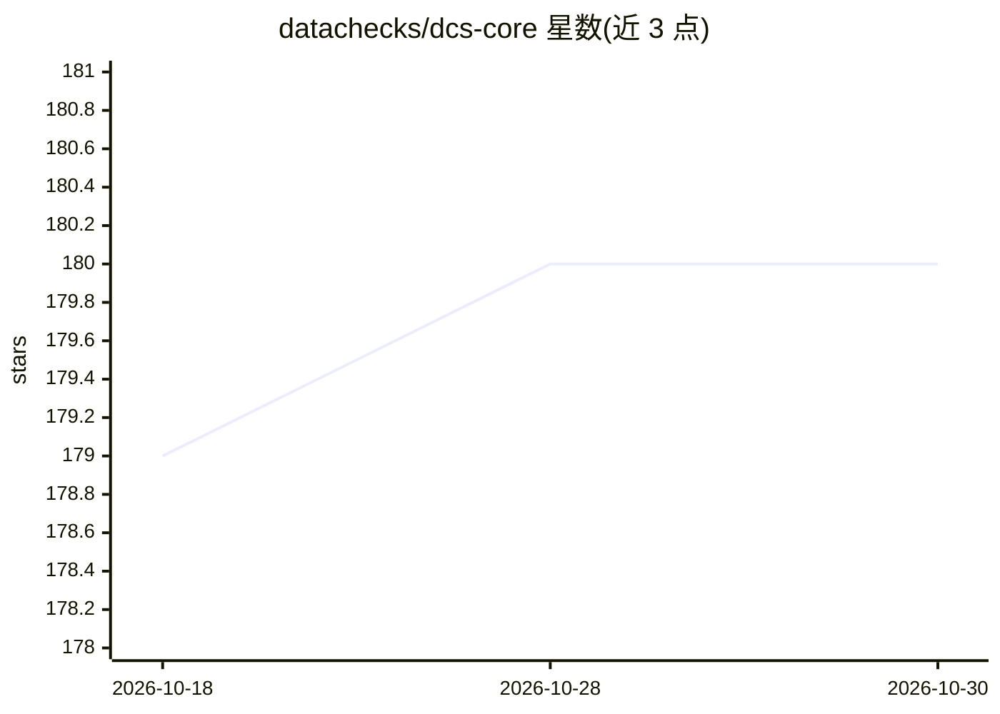

# datachecks/dcs-core

⭐ 180 · Python · Apache-2.0 · 推送 2026-02-09 · [GitHub](https://github.com/datachecks/dcs-core) · [官网](https://docs.datachecks.io) · 组织维护

**开源数据质量监控工具：监测数据库与数据管道质量**

面向数据工程的开源数据质量监控工具：通过配置文件连接 SQL 与搜索类数据源（Postgres、MySQL、Oracle、BigQuery、Snowflake、Elasticsearch 等 11 种），生成可靠性、数值分布、唯一性、完整性、有效性五类指标；可用单条 CLI 命令在终端输出报告或生成可分享的 HTML 报告。以 pip 包（dcs-core）形式提供，帮助定位数据库与数据管道中的数据质量问题根因。README 未声明其使用 AI/ML 方法。

## 筛选速览

| 维度 | 判定 | 备注 |
|---|---|---|
| AI 角色 | `ai-ecosystem` | LLM/agent 周边工具 |
| 许可风险 | `permissive` | Apache-2.0 |
| 部署形态 | `library` | 以包/库形式分发 |
| 模型依赖 | — | README 未给出锁定关系 |
| 硬件要求 | — | 无带数字的原话,不猜 |
| 安装摩擦 | `low` | 无编译、无系统依赖或容器化 |
| 成熟度 | — | 结构信号不足 |

## 能力要点

- 支持 11 种数据源（关系库、搜索引擎、数仓）
- 五类校验指标：可靠性/数值分布/唯一性/完整性/有效性
- 单命令生成终端或 HTML 数据质量报告

## 适用场景

- 监控数据管道与数据库的数据质量
- 排查缺失值、重复、分布漂移等数据问题
- 生成可分享给团队的数据质量报告

## 场景标签

`MLOps` · 领域:训练与推理

## 证据(README 行号)

> L31: Datachecks is an open-source data monitoring tool that helps to monitor the data quality of databases and data pipe
> L34: Datachecks can generate several reliability, uniqueness, completeness metrics from several data sources

## 星数曲线

2026-10-18 179 → 2026-10-30 180（+1）

---
*卡片 v1 · prompt 1.4 · 生成 2026-10-22 · 置信度 low · 依据 README sha `a38ff500afa4` · [字段定义](../../DATASET.md)*
