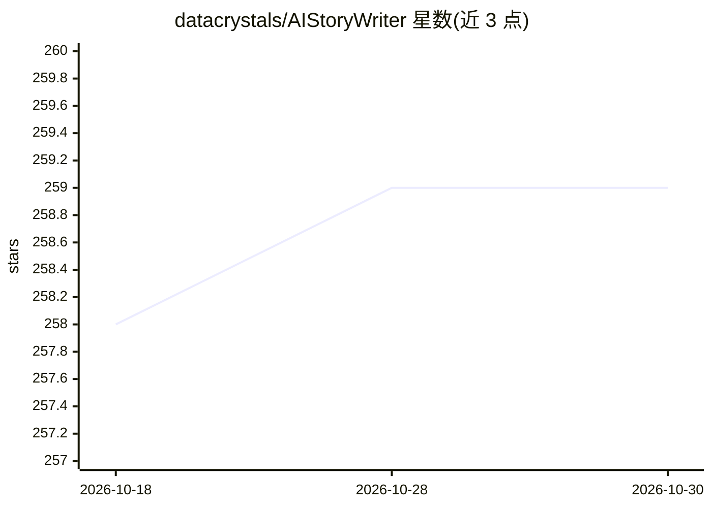

# datacrystals/AIStoryWriter

⭐ 259 · Python · AGPL-3.0 · 推送 2025-11-24 · [GitHub](https://github.com/datacrystals/AIStoryWriter) · 个人维护

**基于 LLM 的长篇小说生成命令行工具**

Python 命令行工具：读取用户提供的提示词文件，分阶段（初始大纲、章节大纲、正文写作）生成中篇至长篇小说，并为各阶段分别指定模型。支持 ollama/google/openrouter 三种模型提供方，本地经 Ollama 运行并自动下载所需模型，云端需在 .env 填 API key；默认模型与主机可通过命令行参数或 Config.py 修改，默认主机 127.0.0.1:11434。README 同时列出待改进项（重复短语、章节衔接、节奏、生成速度）。AGPL-3.0 许可。

## 筛选速览

| 维度 | 判定 | 备注 |
|---|---|---|
| AI 角色 | `ai-native` | 本体是模型或模型工具 |
| 许可风险 | `viral` | AGPL-3.0 |
| 部署形态 | `None` |  |
| 模型依赖 | local-ok | 支持本地模型 |
| 硬件要求 | — | 无带数字的原话,不猜 |
| 安装摩擦 | `low` | 无编译、无系统依赖或容器化 |
| 成熟度 | — | 结构信号不足 |

## 能力要点

- 多阶段流水线生成中长篇小说，各阶段可配置不同模型
- 支持 ollama / google / openrouter 三种提供方
- 经 Ollama 本地运行并自动下载模型，无需本地 GPU 也可用云端
- 生成结果支持翻译为各语言

## 适用场景

- 根据自写提示词生成中长篇小说初稿
- 本地 Ollama 模型离线生成故事
- 对不同写作阶段组合不同模型做实验

## 场景标签

`AI 写作` · 领域:内容生成

## 证据(README 行号)

> L3: Generate full-length novels with AI! Harness the power of large language models to create engaging stories based on 
> L9: - Generate medium to full-length novels: Produce substantial stories with coherent narratives, suitable for novella 
> L60: - Supported providers: `ollama`, `google`, `openrouter`

## 星数曲线

2026-10-18 258 → 2026-10-30 259（+1）

---
*卡片 v1 · prompt 1.4 · 生成 2026-10-22 · 置信度 high · 依据 README sha `f90fff2b0579` · [字段定义](../../DATASET.md)*
