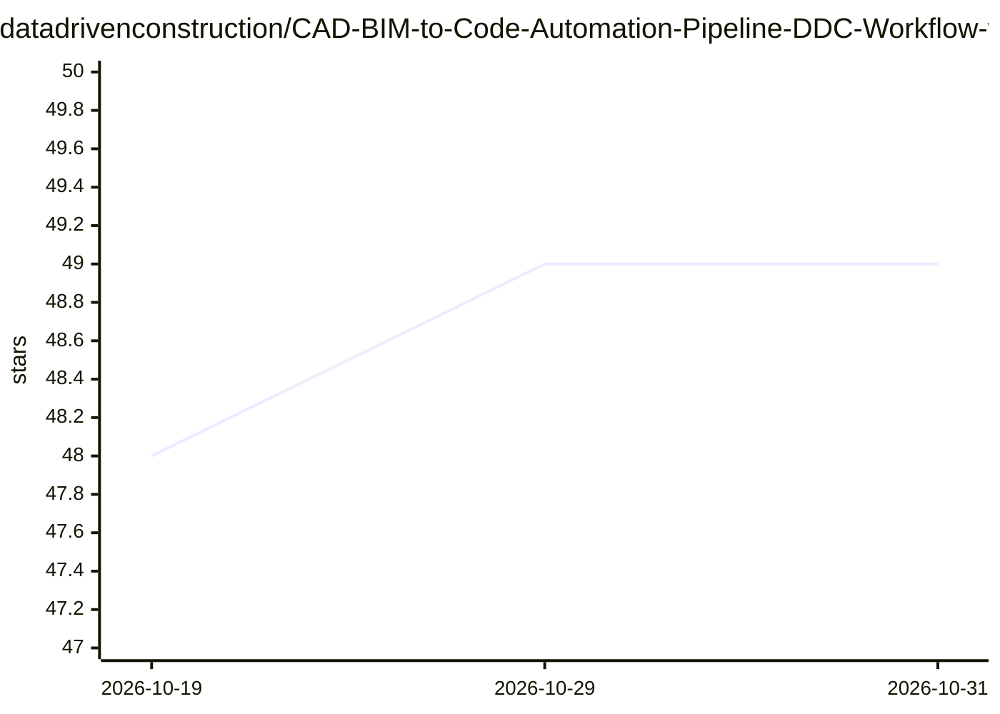

# datadrivenconstruction/CAD-BIM-to-Code-Automation-Pipeline-DDC-Workflow-with-LLM-ChatGPT

⭐ 49 · Jupyter Notebook · MIT · 推送 2026-10-19 · [GitHub](https://github.com/datadrivenconstruction/CAD-BIM-to-Code-Automation-Pipeline-DDC-Workflow-with-LLM-ChatGPT) · [官网](https://datadrivenconstruction.io/) · 组织维护

**n8n 工作流：将 Revit/IFC/DWG 文件转 Excel 并用 LLM 生成 Python 分析**

基于 n8n 的自动化流水线，使用 DataDrivenConstruction 的离线 .exe 转换器将 Revit (.rvt)、IFC、AutoCAD (.dwg)、MicroStation (.dgn) 文件转换为 Excel 元素数据矩阵、Collada 几何、明细表与 PDF 图纸，无需 Autodesk 或 openBIM 工具。转换后可让 AI（ChatGPT/LLM）根据自然语言提示生成定制 Python 代码，产出图表、统计与汇总，并附带验证规则做质量控制。面向 AEC 领域希望离线自动分析 BIM/CAD 数据的用户，需自行安装 n8n（npm/桌面版）并配置转换器路径。

## 筛选速览

| 维度 | 判定 | 备注 |
|---|---|---|
| AI 角色 | `ai-ecosystem` | LLM/agent 周边工具 |
| 许可风险 | `permissive` | MIT |
| 部署形态 | `desktop` | 安装包/桌面程序 |
| 模型依赖 | — | README 未给出锁定关系 |
| 硬件要求 | — | 无带数字的原话,不猜 |
| 安装摩擦 | `low` | 无编译、无系统依赖或容器化 |
| 成熟度 | — | 结构信号不足 |

## 能力要点

- rvt/ifc/dwg/dgn 转 Excel 元素矩阵与 Collada 几何
- 自然语言提示让 AI 生成定制 Python 分析代码
- 离线 .exe 转换器，无需 Autodesk/openBIM 工具
- 内置质量控制验证规则与 Revit/IFC 验证模板

## 适用场景

- 把 Revit 模型数据导出 Excel 做统计分析
- 用自然语言让 AI 生成分组统计和图表，无需写代码
- 离线环境下批量处理 BIM/CAD 文件

## 场景标签

`工作流自动化` `文档解析` `代码生成` · 领域:效率与自动化

## 证据(README 行号)

> L7: **Revit (.rvt), AutoCAD (.dwg), IFC, MicroStation (.dgn) → Excel + AI-Generated Python Analysis — no Autodesk® or op
> L19: - 🤖 Ask AI to generate custom Python code
> L92: - `n8n`

## 星数曲线

2026-10-19 48 → 2026-10-31 49（+1）

---
*卡片 v1 · prompt 1.4 · 生成 2026-10-25 · 置信度 mid · 依据 README sha `af4c877a3060` · [字段定义](../../DATASET.md)*
