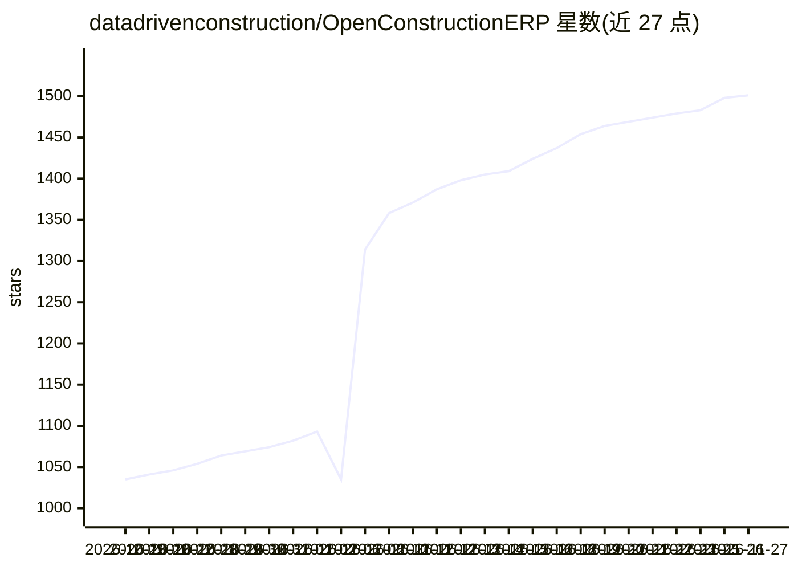

# datadrivenconstruction/OpenConstructionERP

⭐ 1,501 · TypeScript · AGPL-3.0 · 推送 2026-11-26 · [GitHub](https://github.com/datadrivenconstruction/OpenConstructionERP) · [官网](https://openconstructionerp.com) · 组织维护

**给建筑企业做 BOQ/算量/5D 成本与招投标的自托管 ERP**

自托管的开源建筑 ERP，覆盖工程量清单、IFC/Revit/DWG/PDF 算量、4D 进度、5D 成本与招投标流程。内置 120,000+ 条计价项（9 个成本库，覆盖 40+ 市场）、DIN 276/NRM/MasterFormat 校验规则、45 种界面语言与 240+ 模块市场。AI 部分为可接入 LLM 提供商的估价、PDF 量提取与快速估算功能，附置信度评分。提供 Windows/macOS/Linux 桌面安装包、pip 与 Docker 三种安装方式，启动后打开 localhost:8080 并自带演示数据。AGPL-3.0 许可。

## 筛选速览

| 维度 | 判定 | 备注 |
|---|---|---|
| AI 角色 | `ai-enhanced` | 去掉 AI 部分产品仍成立 |
| 许可风险 | `viral` | AGPL-3.0 |
| 部署形态 | `desktop` | 安装包/桌面程序 |
| 模型依赖 | — | README 未给出锁定关系 |
| 硬件要求 | — | 无带数字的原话,不猜 |
| 安装摩擦 | `low` | 无编译、无系统依赖或容器化 |
| 成熟度 | — | 结构信号不足 |

## 能力要点

- IFC/Revit/DWG/PDF 多源算量，量值与图元关联
- 120,000+ 条计价项覆盖 40+ 市场的成本库
- DIN 276/NRM/MasterFormat 规则校验并输出质量评分
- 接入任意 LLM 提供商的文本/照片/PDF 快速估价

## 适用场景

- 从 BIM 模型和图纸提取工程量并生成报价清单
- 多国项目中套用本地成本库和地区标准编制估算
- 自托管管理项目财务、进度与招投标数据

## 场景标签

`文档解析` · 领域:知识与检索

## 证据(README 行号)

> L7: **The open-source construction ERP.** BOQ, BIM and CAD takeoff, 4D scheduling, 5D cost and tendering in one self-hos
> L122: |**AI-powered**|Connect any LLM provider (Anthropic, OpenAI, Gemini, Mistral, Groq, DeepSeek) for smart estimation
> L199:  Drop a drawing, let AI extract the quantities, then push them straight into the BOQ.

## 星数曲线

2026-10-25 1,035 → 2026-11-27 1,501（+466）

---
*卡片 v1 · prompt 1.4 · 生成 2026-11-27 · 置信度 mid · 依据 README sha `b15012cdae5d` · [字段定义](../../DATASET.md)*
