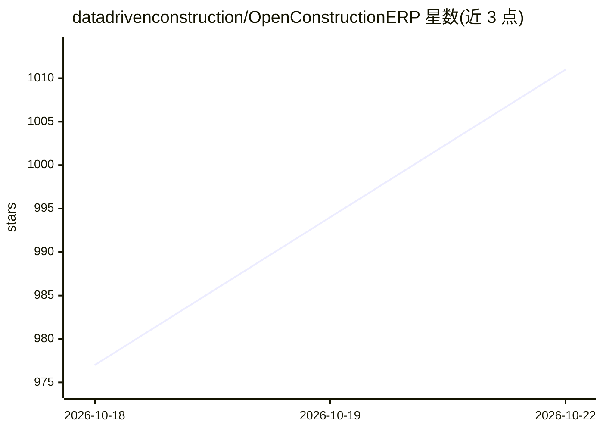

# datadrivenconstruction/OpenConstructionERP

⭐ 1,019 · TypeScript · AGPL-3.0 · 推送 2026-10-22 · [GitHub](https://github.com/datadrivenconstruction/OpenConstructionERP) · [官网](https://openconstructionerp.com) · 组织维护

**自托管建筑造价与项目管理 ERP，带 AI 估价功能**

面向建筑企业的开源（AGPL-3.0）一体化平台：工程量清单（BOQ）、CAD/BIM/PDF 算量、4D 进度、5D 成本模型与招投标管理。内置 120,000+ 条价格数据覆盖 40+ 市场、支持 44 种语言与 30+ 区域标准。采用 WordPress 式模块市场架构（190+ 模块），AI 部分通过接入任意 LLM 供应商（Anthropic/OpenAI/Gemini/Mistral/Groq/DeepSeek）实现智能估价，AI 之外的核心业务功能独立存在。提供桌面安装包、pip 与 Docker 三种安装方式。

## 筛选速览

| 维度 | 判定 | 备注 |
|---|---|---|
| AI 角色 | `ai-enhanced` | 去掉 AI 部分产品仍成立 |
| 许可风险 | `viral` | AGPL-3.0 |
| 部署形态 | `desktop` | 安装包/桌面程序 |
| 模型依赖 | — | README 未给出锁定关系 |
| 硬件要求 | — | 无带数字的原话,不猜 |
| 安装摩擦 | `low` | 无编译、无系统依赖或容器化 |
| 成熟度 | — | 结构信号不足 |

## 能力要点

- BOQ/CAD/BIM/PDF 算量与 4D/5D 成本建模一体化
- 120,000+ 价格条目、44 语言、30+ 区域标准
- 可接入多种 LLM 供应商做 AI 估价
- 190+ 模块的插件式市场架构，自托管

## 适用场景

- 建筑公司自托管管理预算、招投标与进度
- 从 DWG/PDF/BIM 图纸提取工程量并估价
- 多国家/多语言团队按当地标准做成本控制

## 场景标签

 · 领域:建筑工程/造价管理 ERP

## 证据(README 行号)

> L5: OpenConstructionERP - open-source construction ERP for BOQ, BIM takeoff, DWG/PDF quantification and 5D cost modeling
> L146: |**AI-powered**|Connect any LLM provider (Anthropic, OpenAI, Gemini, Mistral, Groq, DeepSeek) for smart estimation

## 星数曲线

2026-10-18 977 → 2026-10-22 1,011（+34）

---
*卡片 v1 · prompt 1.4 · 生成 2026-10-21 · 置信度 high · 依据 README sha `8f2a851f5c5f` · [字段定义](../../DATASET.md)*
