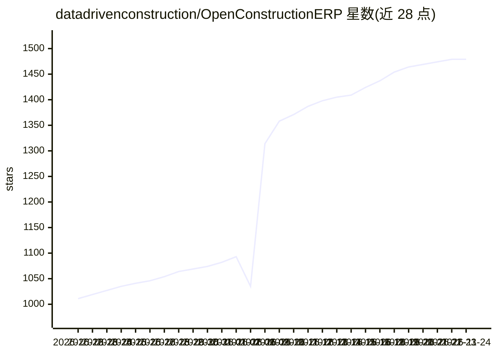

# datadrivenconstruction/OpenConstructionERP

⭐ 1,483 · TypeScript · AGPL-3.0 · 推送 2026-11-23 · [GitHub](https://github.com/datadrivenconstruction/OpenConstructionERP) · [官网](https://openconstructionerp.com) · 组织维护

**面向建筑行业的开源 ERP：算量、BOQ 与 5D 成本估算**

自托管的开源建筑工程 ERP 平台，覆盖 BOQ 编辑、IFC/Revit/DWG/PDF 算量、4D 进度计划、5D 成本与招投标管理。内置 120,000+ 条价格项（覆盖 40+ 市场的 9 个成本库）、240+ 模块、DIN 276/NRM/MasterFormat 等规则校验引擎，UI 提供 45 种语言。可通过桌面安装包、pip 或 Docker 部署，无需额外配置数据库；AGPL-3.0 许可，支持 REST API。AI 部分支持接入多家 LLM 生成估算与 PDF 算量。

## 筛选速览

| 维度 | 判定 | 备注 |
|---|---|---|
| AI 角色 | `ai-enhanced` | 去掉 AI 部分产品仍成立 |
| 许可风险 | `viral` | AGPL-3.0 |
| 部署形态 | `desktop` | 安装包/桌面程序 |
| 模型依赖 | — | README 未给出锁定关系 |
| 硬件要求 | — | 无带数字的原话,不猜 |
| 安装摩擦 | `low` | 无编译、无系统依赖或容器化 |
| 成熟度 | — | 结构信号不足 |

## 能力要点

- 从 IFC/Revit/DWG/PDF 提取工程量并关联到构件
- 接入多家 LLM 供应商（Anthropic/OpenAI/Gemini/Mistral/Groq/DeepSeek）
- 120,000+ 价格项覆盖 40+ 市场，含中国、土耳其、巴西等 8 个国家成本库
- DIN 276、NRM、MasterFormat 规则校验并输出质量评分

## 适用场景

- 从 BIM 模型或图纸直接提量并生成报价清单
- 自托管管理项目财务、进度与招投标数据
- 用文本、照片或表格快速生成初步估算
- 多语言、多国家标准下的跨境工程报价

## 场景标签

 · 领域:建筑/工程成本管理

## 证据(README 行号)

> L7: **The open-source construction ERP.** BOQ, BIM and CAD takeoff, 4D scheduling, 5D cost and tendering in one self-hos
> L122: |**AI-powered**|Connect any LLM provider (Anthropic, OpenAI, Gemini, Mistral, Groq, DeepSeek) for smart estimation

## 星数曲线

2026-10-22 1,011 → 2026-11-24 1,479（+468）

---
*卡片 v1 · prompt 1.4 · 生成 2026-11-23 · 置信度 high · 依据 README sha `353aff32c11e` · [字段定义](../../DATASET.md)*
