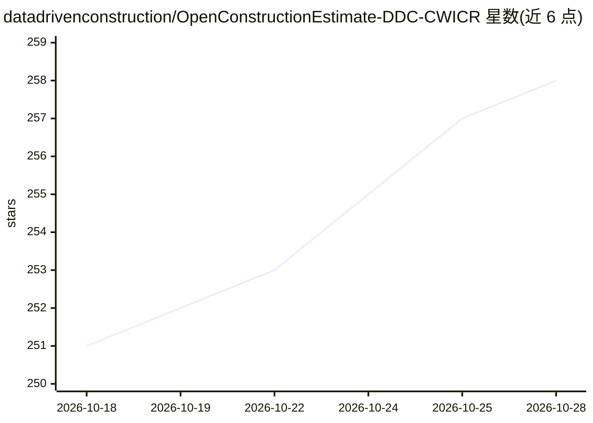

# datadrivenconstruction/OpenConstructionEstimate-DDC-CWICR

⭐ 259 · HTML · NOASSERTION · 推送 2026-08-21 · [GitHub](https://github.com/datadrivenconstruction/OpenConstructionEstimate-DDC-CWICR) · [官网](https://datadrivenconstruction.io/) · 组织维护

**面向 AI Agent 的开放多语言工程造价数据库（5.5万+工作项）**

由 DataDrivenConstruction 维护的建筑造价数据集：按国家组织的多国造价基准（如俄罗斯 GESN/FER/TER 55,719 条工作项、中国定额、巴西 SINAPI 等），每库提供 parquet/xlsx/csv 格式的 95 列规范数据与 48 个目标市场的重定价版本。内置预计算向量与 Qdrant 语义检索（11 种语言集合）、REST 定价查询 API，并附 4 个 n8n 工作流，支持从文本、照片/PDF、CAD(BIM) 三类输入生成估价。数据 CC BY-NC 4.0，代码 Apache-2.0，另有商业许可。

## 筛选速览

| 维度 | 判定 | 备注 |
|---|---|---|
| AI 角色 | `ai-knowledge` | 知识聚合/清单类 |
| 许可风险 | `none` | NOASSERTION |
| 部署形态 | `desktop` | 安装包/桌面程序 |
| 模型依赖 | — | README 未给出锁定关系 |
| 硬件要求 | — | 无带数字的原话,不猜 |
| 安装摩擦 | `low` | 无编译、无系统依赖或容器化 |
| 成熟度 | — | 结构信号不足 |

## 能力要点

- 55,719 条工作项、27K+ 资源、覆盖 30 地区的多国造价基准库
- 预计算向量与 Qdrant 语义检索（11 种语言集合）
- 4 个 n8n 工作流：文本/照片 PDF/CAD(BIM) 输入生成估价
- 配 196 个 DDC Skills 供 AI Agent 直接调用

## 适用场景

- 造价师或 AI 机器人按地区查询本地化工程单价
- 从 Telegram 文本、现场照片或 Revit/IFC 模型自动生成 BoQ 估价
- 为建筑 AI 应用提供结构化多语言造价语料与语义检索

## 场景标签

`语义搜索` `数据分析` · 领域:效率与自动化

## 证据(README 行号)

> L1: DDC CWICR - Construction Work Items, Components & Resources
> L152: The repository is organised by source country. Each top-level folder is one
> L157: |`CIS-Russia-GESN-FER-TER/`|CIS base, 30 language and market editions, 55,719 work items|GESN / FER / TER|

## 星数曲线

2026-10-18 251 → 2026-10-28 258（+7）

---
*卡片 v1 · prompt 1.4 · 生成 2026-10-22 · 置信度 mid · 依据 README sha `aed0d776b569` · [字段定义](../../DATASET.md)*
