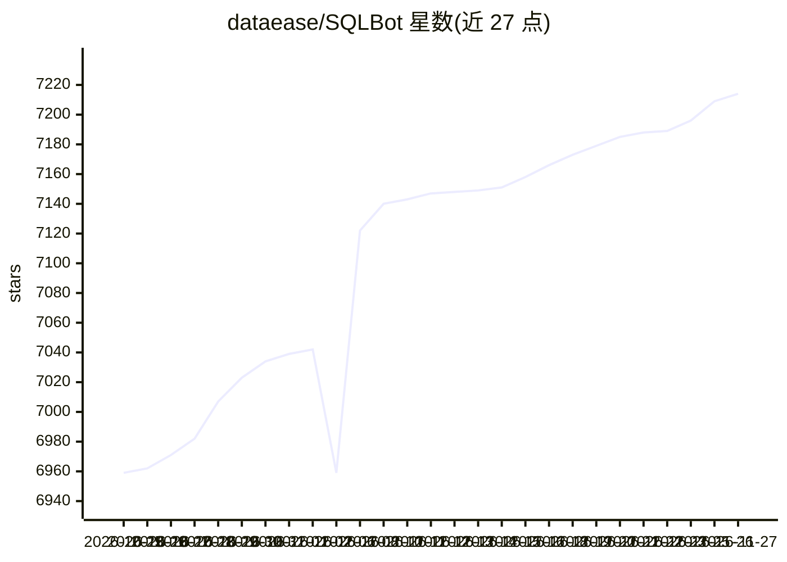

# dataease/SQLBot

⭐ 7,214 · JavaScript · NOASSERTION · 推送 2026-11-26 · [GitHub](https://github.com/dataease/SQLBot) · [官网](https://sqlbot.org/) · 组织维护 · 中文 README

**基于大模型与 RAG 的对话式数据分析（ChatBI）问数系统**

SQLBot 由 DataEase 开源项目组出品，用户配置大模型与数据源后即可通过自然语言对话查询数据并生成可视化图表。核心机制包括：结合 RAG 技术的 Text-to-SQL 转换、工作空间级资源隔离与细粒度数据权限、自定义提示词与术语库及 SQL 示例校准。集成方式涵盖 Web 嵌入、弹窗嵌入与 MCP 调用。README 提供 Docker 一键安装、1Panel 应用商店与离线安装包三种部署方式，默认面向 Linux 服务器环境。

## 筛选速览

| 维度 | 判定 | 备注 |
|---|---|---|
| AI 角色 | `ai-native` | 本体是模型或模型工具 |
| 许可风险 | `none` | NOASSERTION |
| 部署形态 | `self-host` | docker 或自建部署 |
| 模型依赖 | — | README 未给出锁定关系 |
| 硬件要求 | — | 无带数字的原话,不猜 |
| 安装摩擦 | `low` | 无编译、无系统依赖或容器化 |
| 成熟度 | — | 结构信号不足 |

## 能力要点

- 结合 RAG 的 Text-to-SQL 转换，对话式获取数据与图表
- 工作空间级资源隔离与细粒度数据权限配置
- 支持 Web 嵌入、弹窗嵌入、MCP 调用等集成方式
- 自定义提示词、术语库与 SQL 示例校准

## 适用场景

- 业务人员用自然语言查询数据库并生成图表
- 把智能问数能力嵌入到自有应用或 BI 系统中
- 通过 MCP 调用让其他工具获得问数能力

## 场景标签

`数据分析` `RAG` · 领域:效率与自动化

## 证据(README 行号)

> L15: SQLBot 是一款基于大语言模型和 RAG 的智能问数系统，由 DataEase 开源项目组匠心出品。借助 SQLBot，用户可以实现对话式数据分析（ChatBI），快速提炼获取所需的数据信息及可视化图表，并且支持进一步开展智能
> L23: - **开箱即用**：仅需简单配置大模型与数据源，无需复杂开发，即可快速开启智能问数；依托大模型自然语言理解与 SQL 生成能力，结合 RAG 技术，实现高质量 Text-to-SQL 转换。

## 星数曲线

2026-10-25 6,959 → 2026-11-27 7,214（+255）

---
*卡片 v1 · prompt 1.4 · 生成 2026-11-23 · 置信度 high · 依据 README sha `e5727134c93a` · [字段定义](../../DATASET.md)*
