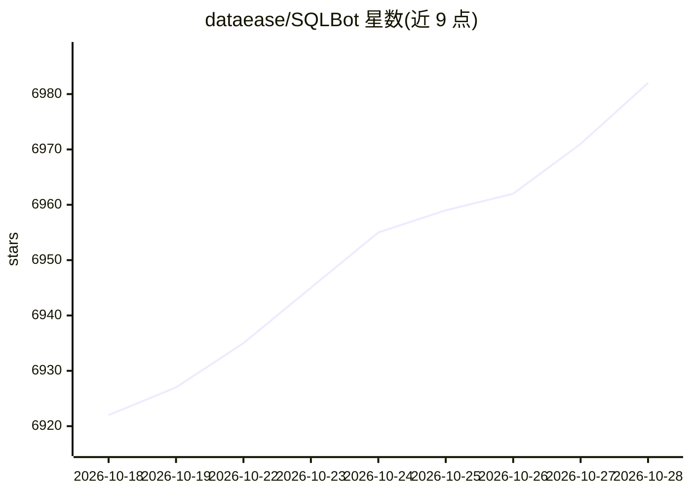

# dataease/SQLBot

⭐ 7,007 · JavaScript · NOASSERTION · 推送 2026-10-28 · [GitHub](https://github.com/dataease/SQLBot) · [官网](https://sqlbot.org/) · 组织维护 · 中文 README

**基于大模型与 RAG 的对话式问数系统（ChatBI/Text-to-SQL）**

由 DataEase 开源项目组发布的智能问数系统：用户以自然语言提问，系统结合 RAG 与大语言模型生成 SQL，返回数据信息与可视化图表，并支持后续智能分析。提供工作空间级资源隔离与细粒度数据权限，支持自定义提示词、术语库与 SQL 示例校准。可通过 Web 嵌入、弹窗嵌入、MCP 调用集成到 n8n、Dify、MaxKB、DataEase 等应用。Docker 一键脚本部署，浏览器访问使用，许可为 FIT2CLOUD Open Source License（GPLv3 加附加限制）。

## 筛选速览

| 维度 | 判定 | 备注 |
|---|---|---|
| AI 角色 | `ai-native` | 本体是模型或模型工具 |
| 许可风险 | `none` | NOASSERTION |
| 部署形态 | `self-host` | docker 或自建部署 |
| 模型依赖 | — | README 未给出锁定关系 |
| 硬件要求 | — | 无带数字的原话,不猜 |
| 安装摩擦 | `low` | 无编译、无系统依赖或容器化 |
| 成熟度 | — | 结构信号不足 |

## 能力要点

- 自然语言问数，结合 RAG 生成 SQL 并输出可视化图表
- 工作空间级资源隔离与细粒度数据权限配置
- Web 嵌入、弹窗嵌入、MCP 调用等集成方式
- 自定义提示词、术语库与 SQL 示例校准

## 适用场景

- 业务人员用对话方式查询数据库并获取图表
- 把智能问数能力嵌入 Dify、MaxKB、DataEase 等应用
- 通过运营交互数据持续提升问数准确度

## 场景标签

`数据分析` · 领域:效率与自动化

## 证据(README 行号)

> L15: SQLBot 是一款基于大语言模型和 RAG 的智能问数系统，由 DataEase 开源项目组匠心出品。借助 SQLBot，用户可以实现对话式数据分析（ChatBI），快速提炼获取所需的数据信息及可视化图表，并且支持进一步开展智能
> L23: - **开箱即用**：仅需简单配置大模型与数据源，无需复杂开发，即可快速开启智能问数；依托大模型自然语言理解与 SQL 生成能力，结合 RAG 技术，实现高质量 Text-to-SQL 转换。

## 星数曲线

2026-10-18 6,922 → 2026-10-28 6,982（+60）

---
*卡片 v1 · prompt 1.4 · 生成 2026-10-20 · 置信度 high · 依据 README sha `798079b815f6` · [字段定义](../../DATASET.md)*
