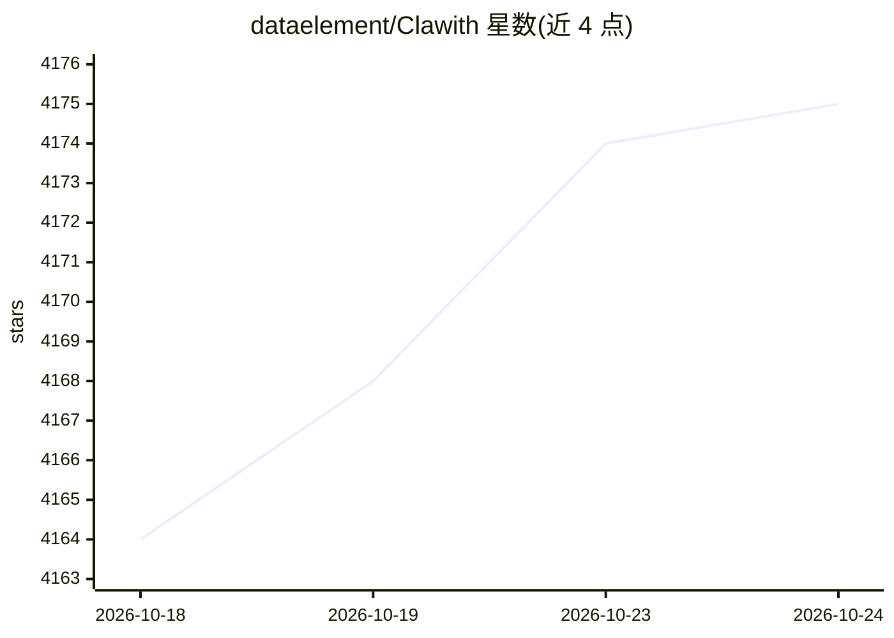

# dataelement/Clawith

⭐ 4,177 · Python · Apache-2.0 · 推送 2026-08-27 · [GitHub](https://github.com/dataelement/Clawith) · [官网](https://www.clawith.ai) · 组织维护 · 中文 README

**开源多智能体协作平台，给团队提供持久身份的 AI agent**

面向团队的开源多智能体协作平台：每个 agent 拥有持久身份（soul.md 人格、memory.md 长期记忆）、独立工作区与沙箱代码执行，可通过 Plaza 知识流互通，并支持自主感知系统 Aware（六类触发器：cron/once/interval/poll/on_message/webhook）。平台提供多租户 RBAC、Slack/Discord/飞书频道集成、用量配额、审批流与审计日志；agent 可在运行时从 Smithery 与 ModelScope 发现安装新工具。本地部署不运行模型，LLM 推理全部由外部 API 提供商（OpenAI、Anthropic 等）承担。支持 Docker 编排或 setup.sh 一键部署，需 Python 3.12+、Node.js 20+、PostgreSQL 15+（或 SQLite）。另有托管云服务 Clawith Cloud。

## 筛选速览

| 维度 | 判定 | 备注 |
|---|---|---|
| AI 角色 | `ai-ecosystem` | LLM/agent 周边工具 |
| 许可风险 | `permissive` | Apache-2.0 |
| 部署形态 | `self-host` | docker 或自建部署 |
| 模型依赖 | — | README 未给出锁定关系 |
| 硬件要求 | — | 无带数字的原话,不猜 |
| 安装摩擦 | `low` | 无编译、无系统依赖或容器化 |
| 成熟度 | — | 结构信号不足 |

## 能力要点

- agent 持久身份：soul.md 人格 + memory.md 长期记忆 + 私有文件系统
- Aware 自主感知系统，六种触发器类型含 cron/poll/webhook
- 多租户 RBAC、用量配额、审批工作流与审计日志
- agent 运行时从 Smithery/ModelScope 发现并安装新工具

## 适用场景

- 团队部署多个有持久身份的数字员工协作工作
- 通过 Slack/Discord/飞书频道让 agent 参与团队沟通
- 企业按配额与审批流管控 agent 的 LLM 调用与危险操作

## 场景标签

`多智能体` · 领域:Agent 开发

## 证据(README 行号)

> L26: Clawith is an open-source multi-agent collaboration platform. Unlike single-agent tools, Clawith gives every AI age
> L67: > **Note:** Clawith does not run any AI models locally — all LLM inference is handled by external API providers (Op
> L50: - **Audit logs & Knowledge Base** — full traceability + shared enterprise context injected automatically

## 星数曲线

2026-10-18 4,164 → 2026-10-24 4,175（+11）

---
*卡片 v1 · prompt 1.4 · 生成 2026-10-20 · 置信度 mid · 依据 README sha `66876bba99a1` · [字段定义](../../DATASET.md)*
