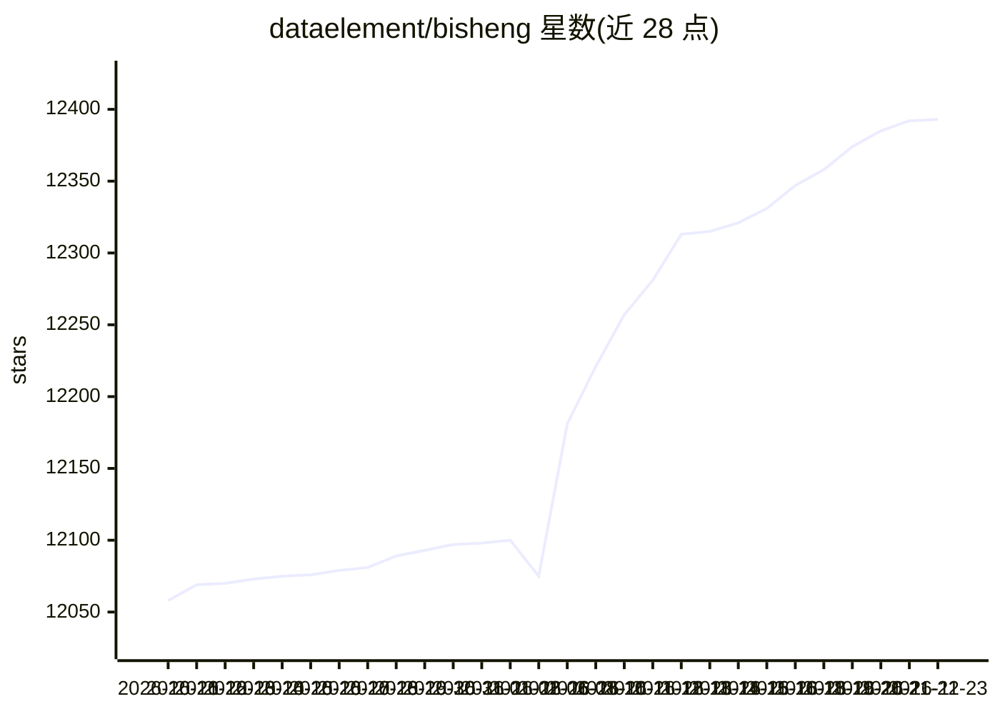

# dataelement/bisheng

⭐ 12,393 · Python · Apache-2.0 · 推送 2026-11-22 · [GitHub](https://github.com/dataelement/bisheng) · [官网](http://www.bisheng.ai) · 组织维护 · 中文 README

**面向企业的开源一站式 Agent 平台：构建、部署与管理 AI 应用**

BISHENG 定位企业级 Agent 平台，包含客户端（基于 DSHDesktop）、托管应用发布、多步骤任务模式 Agent（任务规划、子 Agent 并行、Human in the loop）、知识空间与文档权限管理、workflow 编排框架（支持成环/并行/批量）、RBAC/ReBAC 权限与审计、高精度文档解析模型等模块。部署依赖 Docker Compose，默认含 MySQL、Redis、MinIO、ES、Milvus 等组件；统计看板标注为商业版功能。

## 筛选速览

| 维度 | 判定 | 备注 |
|---|---|---|
| AI 角色 | `ai-ecosystem` | LLM/agent 周边工具 |
| 许可风险 | `permissive` | Apache-2.0 |
| 部署形态 | `self-host` | docker 或自建部署 |
| 模型依赖 | — | README 未给出锁定关系 |
| 硬件要求 | — | 无带数字的原话,不猜 |
| 安装摩擦 | `low` | 无编译、无系统依赖或容器化 |
| 成熟度 | — | 结构信号不足 |

## 能力要点

- 任务模式 Agent：任务规划+子 Agent 并行+Human in the loop，交付 HTML/Markdown/PPT/Excel/Word
- workflow 编排支持成环、并行、批量运行自由组合
- 知识空间三级权限（空间/文件夹/文件）与回答引用溯源
- 高精度文档解析模型支持免费私有化部署

## 适用场景

- 企业内构建并审批发布 AI 应用给同事使用
- 搭建带细粒度权限的团队知识库问答
- 文档审核、固定版式报告生成等流程自动化
- 私有化部署企业级 Agent 与模型管理平台

## 场景标签

`聊天机器人` `文档问答` `文档解析` `Agent 框架` · 领域:Agent 开发

## 证据(README 行号)

> L17: BISHENG是一款 开源的企业级一站式 Agent 平台 ，专注办公效率与企业 AI 应用落地，已有大量行业头部组织及世界 500 强企业在使用。
> L79:  - **独立、完备的应用编排框架**：不区分 chatflow 和 workflow，多轮对话和自动化处理可以混在同一个流程里。
> L86:  - **客户端统一管理**：管理员集中配置 BISHENG 客户端可用的模型、技能、API/MCP 工具与知识空间，通过企业插件市场分发插件和工作台，并统一管理模型授权、月度积分和调用记录。

## 星数曲线

2026-10-21 12,058 → 2026-11-23 12,393（+335）

---
*卡片 v1 · prompt 1.4 · 生成 2026-11-22 · 置信度 high · 依据 README sha `d27873205472` · [字段定义](../../DATASET.md)*
