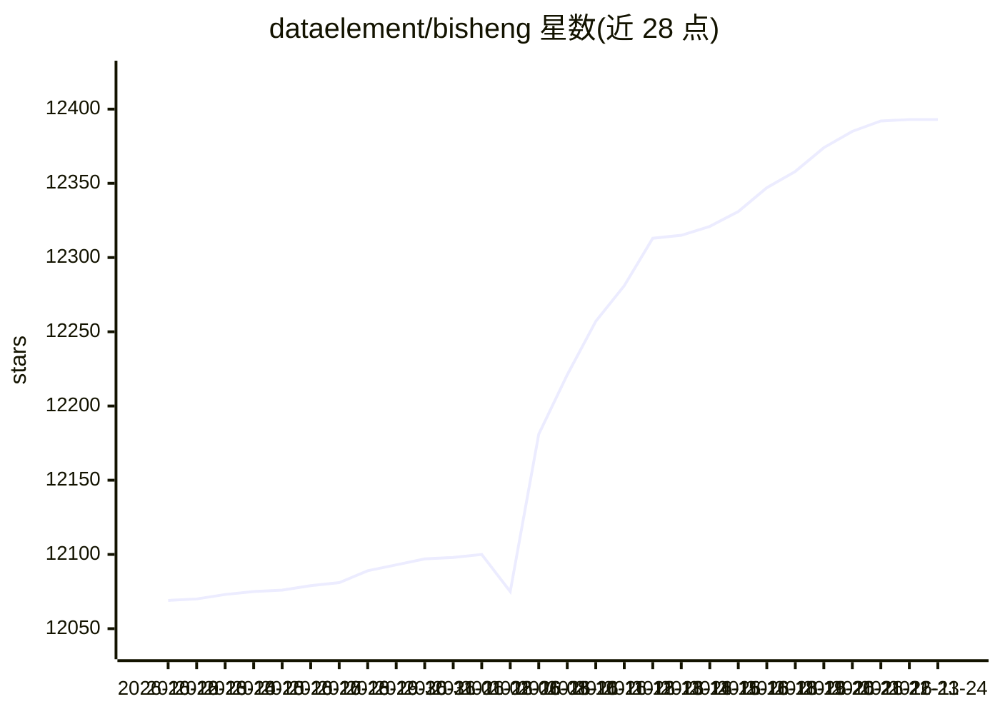

# dataelement/bisheng

⭐ 12,414 · Python · Apache-2.0 · 推送 2026-11-23 · [GitHub](https://github.com/dataelement/bisheng) · [官网](http://www.bisheng.ai) · 组织维护 · 中文 README

**企业级开源 Agent 平台：构建、部署与管理 AI 应用**

BISHENG 定位为开源企业级一站式 Agent 平台，覆盖 Agent 任务模式（任务规划、子 Agent 并行、Human in the loop、技能包）、workflow 编排、企业知识空间与文档问答、频道资讯订阅、托管应用开发与审批上线，以及客户端统一管理、RBAC/ReBAC 权限、审计等企业管控能力。附带基于 DSH 的桌面客户端，可私有化部署。商业版提供统计看板。部署需 Docker Compose，硬件要求 8 核 CPU、32GB 内存。

## 筛选速览

| 维度 | 判定 | 备注 |
|---|---|---|
| AI 角色 | `ai-ecosystem` | LLM/agent 周边工具 |
| 许可风险 | `permissive` | Apache-2.0 |
| 部署形态 | `self-host` | docker 或自建部署 |
| 模型依赖 | — | README 未给出锁定关系 |
| 硬件要求 | — | 无带数字的原话,不猜 |
| 安装摩擦 | `low` | 无编译、无系统依赖或容器化 |
| 成熟度 | — | 结构信号不足 |

## 能力要点

- 任务模式通用 Agent：任务规划、子 Agent 并行、Human in the loop、内置 Word/Excel/PPT/HTML 技能包
- workflow 编排支持成环、并行、批量运行组合
- 知识空间支持文件级权限、引用溯源问答
- 高精度文档解析模型（印刷体/手写体/表格/版式/印章）支持免费私有化部署

## 适用场景

- 企业搭建可私有化部署的 AI Agent 应用并统一管控模型与权限
- 团队用任务模式生成带引用溯源的 Word、Excel、PPT 报告
- 构建带审批流的应用发布管理流程
- 搭建文档问答与团队知识库

## 场景标签

`文档解析` `文档问答` `Agent 框架` · 领域:Agent 开发

## 证据(README 行号)

> L17: BISHENG是一款 开源的企业级一站式 Agent 平台 ，专注办公效率与企业 AI 应用落地，已有大量行业头部组织及世界 500 强企业在使用。
> L47:  - **本地开发后提交到平台**：开发者安装 bisheng 命令行工具，用服务账号密钥登录，在本地开发和调试应用，也可以让 Coding Agent 辅助开发。开发者在应用清单中声明运行时、资源档位、要用的平台模型和知识库，再
> L86:  - **客户端统一管理**：管理员集中配置 BISHENG 客户端可用的模型、技能、API/MCP 工具与知识空间，通过企业插件市场分发插件和工作台，并统一管理模型授权、月度积分和调用记录。

## 星数曲线

2026-10-22 12,069 → 2026-11-24 12,393（+324）

---
*卡片 v1 · prompt 1.4 · 生成 2026-11-24 · 置信度 high · 依据 README sha `5fa9dcbcc102` · [字段定义](../../DATASET.md)*
