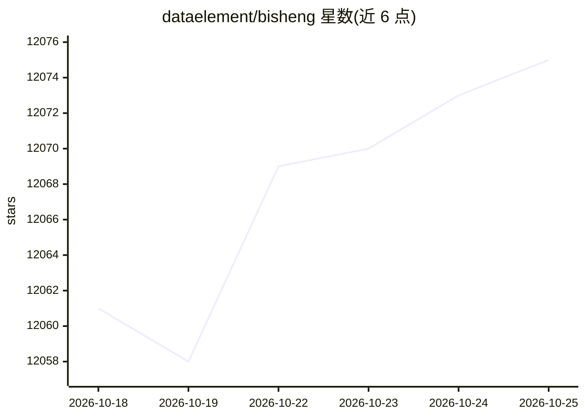

# dataelement/bisheng

⭐ 12,076 · Python · Apache-2.0 · 推送 2026-10-25 · [GitHub](https://github.com/dataelement/bisheng) · [官网](http://www.bisheng.ai) · 组织维护 · 中文 README

**企业级开源 LLM 应用 DevOps 平台：工作流、RAG、Agent 一体化**

面向企业场景的开源 LLM 应用开发运维平台，功能包括通用 Agent 任务模式（任务规划、并行子 Agent、人工介入）、团队知识库（细粒度权限、AI 问答带出处溯源）、工作流编排（循环、并行分支、批量执行）、企业级管理（部门/用户管理、RBAC+ReBAC、审批、审计、SSO/LDAP）、文档解析模型（印刷/手写/表格/印章识别）与信创支持（达梦 DM8）。通过 Docker Compose 部署，需 4 核 CPU、16GB 内存以上，附带 ES、Milvus、Onlyoffice 等组件。含商业版功能（仪表盘、DSH 桌面端）。

## 筛选速览

| 维度 | 判定 | 备注 |
|---|---|---|
| AI 角色 | `ai-ecosystem` | LLM/agent 周边工具 |
| 许可风险 | `permissive` | Apache-2.0 |
| 部署形态 | `self-host` | docker 或自建部署 |
| 模型依赖 | — | README 未给出锁定关系 |
| 硬件要求 | — | 无带数字的原话,不猜 |
| 安装摩擦 | `low` | 无编译、无系统依赖或容器化 |
| 成熟度 | — | 结构信号不足 |

## 能力要点

- 通用 Agent 任务模式：任务清单规划、并行子 Agent、人工介入
- 知识库权限细到单文件，AI 问答答案带可点击的来源引用
- 工作流支持循环、并行分支、批量运行与人机交互节点
- 自研文档解析模型（手写、表格、版面、印章）可私有化部署

## 适用场景

- 企业搭建带权限管控与审计的知识库问答系统
- 用可视化工作流编排多轮对话与自动化文档处理流程
- 让 Agent 按目标拆解任务并交付报告、PPT、Excel 产出物

## 场景标签

`工作流自动化` `文档问答` `RAG` `文档解析` · 领域:效率与自动化

## 证据(README 行号)

> L17: BISHENG is an open LLM application devops platform, focusing on enterprise scenarios. It has been used by a large n
> L22: 1. **🚀 Task Mode: a general-purpose agent for complex, multi-step work**
> L36:  - 💬 **AI Q&A**: Ask questions about one document or about the whole space. Answers show their sources; click a sou

## 星数曲线

2026-10-18 12,061 → 2026-10-25 12,075（+14）

---
*卡片 v1 · prompt 1.4 · 生成 2026-10-20 · 置信度 high · 依据 README sha `8a9ff208cb92` · [字段定义](../../DATASET.md)*
