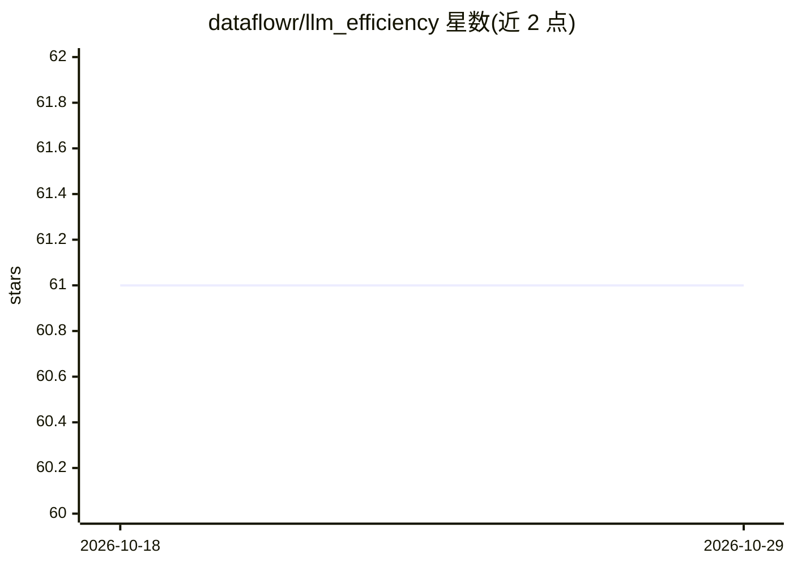

# dataflowr/llm_efficiency

⭐ 61 · Python · Apache-2.0 · 推送 2026-03-04 · [GitHub](https://github.com/dataflowr/llm_efficiency) · 组织维护

**基于 minGPT 的教学作业：实现 KV Cache 与 LoRA**

一个围绕 LLM 推理与微调效率的两部分编程作业，基于 Karpathy 的 minGPT。第一部分要求在 CausalSelfAttention、Block、GPT 类中穿入 KV cache，实现缓存式生成并对比基准速度；第二部分实现带 merge/de-merge 的 LoRALinear，冻结预训练权重只训练低秩适配器，在排序任务上微调以泛化到更长序列。提供 uv 安装、运行脚本、pytest 测试与提交脚本，面向深度学习课程学员。

## 筛选速览

| 维度 | 判定 | 备注 |
|---|---|---|
| AI 角色 | `ai-ecosystem` | LLM/agent 周边工具 |
| 许可风险 | `permissive` | Apache-2.0 |
| 部署形态 | `None` |  |
| 模型依赖 | — | README 未给出锁定关系 |
| 硬件要求 | — | 无带数字的原话,不猜 |
| 安装摩擦 | `low` | 无编译、无系统依赖或容器化 |
| 成熟度 | — | 结构信号不足 |

## 能力要点

- KV Cache 实现：逐步注意力成本从 O(T²) 降至 O(T)
- LoRALinear 带 merge/de-merge 支持，推理时可零开销合并
- 提供基准测试脚本与 pytest 测试套件
- 基于未修改的 minGPT，含 homework.pdf 完整说明

## 适用场景

- 通过动手实现学习 KV Cache 机制
- 通过 LoRA 实现学习参数高效微调
- 课程作业练习与自动评分提交

## 场景标签

`教程课程` · 领域:学习与行业

## 证据(README 行号)

> L3: This homework explores two techniques for making Large Language Model inference and fine-tuning more efficient, buil
> L18: During autoregressive inference, a standard transformer re-encodes the full sequence at every step. KV caching stor
> L22: Standard fine-tuning updates all model parameters, which is expensive for large models. LoRA (Low-Rank Adaptation) 

## 星数曲线

2026-10-18 61 → 2026-10-29 61（+0）

---
*卡片 v1 · prompt 1.4 · 生成 2026-10-24 · 置信度 high · 依据 README sha `4e857883b4ea` · [字段定义](../../DATASET.md)*
