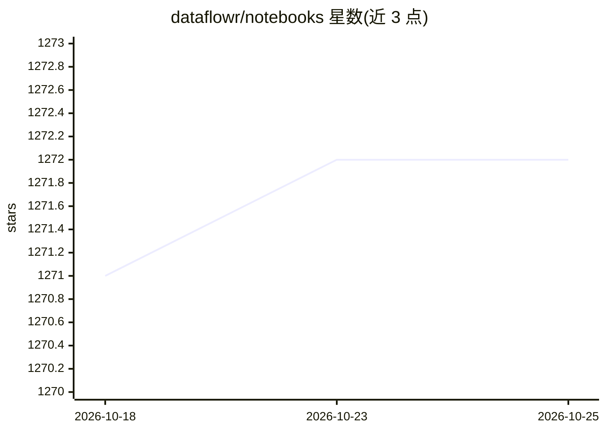

# dataflowr/notebooks

⭐ 1,272 · Jupyter Notebook · Apache-2.0 · 推送 2026-05-29 · [GitHub](https://github.com/dataflowr/notebooks) · [官网](https://dataflowr.github.io/website/) · 个人维护

**深度学习课程配套代码与 Jupyter notebook 集合**

Dataflowr 深度学习课程的代码与 notebook 仓库，按 école polytechnique 2023 年课程进度组织为九个 Session：覆盖 PyTorch 张量与自动微分、CNN、嵌入与协同过滤、自编码器、GAN、RNN、Attention/Transformer、流模型、扩散模型（DDPM）、图神经网络与 NeRF 等，另含三次作业（MLP 从零实现、CAM 与对抗样本、VAE 聚类生成）。大量 notebook 提供空白版与解答版，可在本地或 Colab 运行，2020 版课程归档于 archive-2020 分支。

## 筛选速览

| 维度 | 判定 | 备注 |
|---|---|---|
| AI 角色 | `ai-knowledge` | 知识聚合/清单类 |
| 许可风险 | `permissive` | Apache-2.0 |
| 部署形态 | `None` |  |
| 模型依赖 | — | README 未给出锁定关系 |
| 硬件要求 | — | 无带数字的原话,不猜 |
| 安装摩擦 | `low` | 无编译、无系统依赖或容器化 |
| 成熟度 | — | 结构信号不足 |

## 能力要点

- 覆盖从 MLP、CNN 到 Transformer、DDPM、GNN、NeRF 的课程 notebook
- 多数实践提供空白版与解答版两个版本
- 含 JAX 与 Julia 自动微分补充 notebook
- 2020 版课程内容归档于独立分支

## 适用场景

- 跟随课程系统学习深度学习原理与 PyTorch 实现
- 动手从零实现 MLP、GPT、DDPM 等经典模型
- 查找各主题（批归一化、 dropout、协同过滤等）的可运行示例

## 场景标签

`教程课程` · 领域:学习与行业

## 证据(README 行号)

> L5: Code and notebooks for the deep learning course dataflowr. Here is the schedule followed at école polytechnique in 2
> L92: - **Module 1: Introduction & General Overview**

## 星数曲线

2026-10-18 1,271 → 2026-10-25 1,272（+1）

---
*卡片 v1 · prompt 1.4 · 生成 2026-10-21 · 置信度 high · 依据 README sha `caf6b9784320` · [字段定义](../../DATASET.md)*
