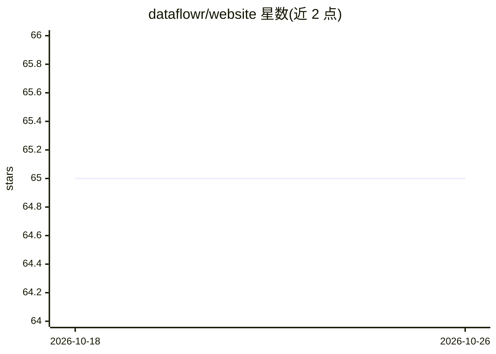

# dataflowr/website

⭐ 65 · CSS · Apache-2.0 · 推送 2025-12-22 · [GitHub](https://github.com/dataflowr/website) · [官网](https://dataflowr.github.io/website/) · 组织维护

**深度学习 DIY 教程模块集合的网站代码**

Deep Learning Do It Yourself 教学站点的源码仓库：以模块形式组织深度学习学习资源，学生可按自身节奏学习并通过数字平台互动，也欢迎贡献者添加模块。站点基于 Julia 的 Franklin 静态站点生成器构建，本地运行需先安装 Julia 并添加 Franklin、JSON 包，或直接用 Makefile 的 make install / make serve 命令在 localhost:8000 提供服务。

## 筛选速览

| 维度 | 判定 | 备注 |
|---|---|---|
| AI 角色 | `ai-knowledge` | 知识聚合/清单类 |
| 许可风险 | `permissive` | Apache-2.0 |
| 部署形态 | `None` |  |
| 模型依赖 | — | README 未给出锁定关系 |
| 硬件要求 | — | 无带数字的原话,不猜 |
| 安装摩擦 | `medium` | 含编译或系统依赖之一 |
| 成熟度 | — | 结构信号不足 |

## 能力要点

- 以模块形式组织的深度学习学习资源
- 基于 Julia + Franklin 静态站点生成器构建
- Makefile 自动化安装与本地 serve（localhost:8000）

## 适用场景

- 按模块自学深度学习并与其他学习者互动
- 为教程站点贡献新的学习模块
- 本地构建预览站点内容

## 场景标签

`教程课程` · 领域:学习与行业

## 证据(README 行号)

> L3: This site collects resources to learn Deep Learning in the form of Modules
> L4: available through the sidebar on the left. As a student, you can walk

## 星数曲线

2026-10-18 65 → 2026-10-26 65（+0）

---
*卡片 v1 · prompt 1.4 · 生成 2026-10-24 · 置信度 high · 依据 README sha `12bf31dee1b5` · [字段定义](../../DATASET.md)*
