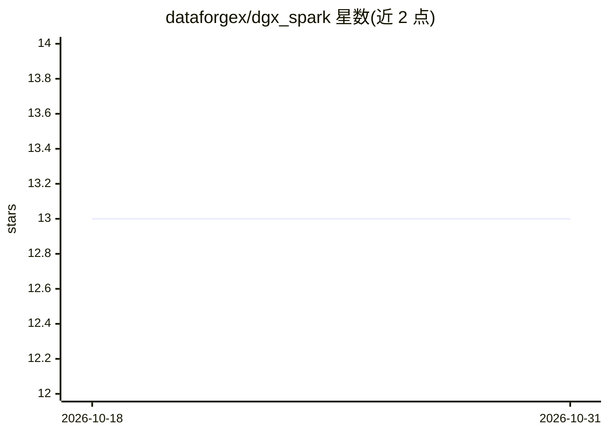

# dataforgex/dgx_spark

⭐ 13 · Python · Apache-2.0 · 推送 2026-01-24 · [GitHub](https://github.com/dataforgex/dgx_spark) · [官网](https://www.acloudpartner.dk) · 个人维护

**面向 DGX Spark 的多模型 LLM 服务套件：vLLM 部署+Web 面板**

面向 NVIDIA DGX Spark（GB10 Blackwell）的本地 LLM 基础设施：通过 vLLM（Docker 内运行）部署 7 个模型（含 Qwen3-Coder-30B、Qwen3-235B 双节点、Qwen2-VL-7B 视觉模型），提供 React Web 仪表盘用于启停模型、GPU 监控与聊天，并在 8100-8235 端口暴露 OpenAI 兼容 API。附带工具调用（Web 搜索 + seccomp 沙箱代码执行）、Bearer 鉴权与限流配置。支持 1 或 2 台 DGX Spark 组网。

## 筛选速览

| 维度 | 判定 | 备注 |
|---|---|---|
| AI 角色 | `ai-ecosystem` | LLM/agent 周边工具 |
| 许可风险 | `permissive` | Apache-2.0 |
| 部署形态 | `self-host` | docker 或自建部署 |
| 模型依赖 | local-ok | 支持本地模型 |
| 硬件要求 | — | 无带数字的原话,不猜 |
| 安装摩擦 | `low` | 无编译、无系统依赖或容器化 |
| 成熟度 | — | 结构信号不足 |

## 能力要点

- vLLM 部署 7 个模型，提供 OpenAI 兼容 API（端口 8100-8235）
- Web 仪表盘：模型启停、GPU 监控、聊天界面
- 工具调用：Web 搜索 + seccomp 沙箱代码执行
- 支持 1-2 台 DGX Spark（235B 模型双节点部署）

## 适用场景

- 在 DGX Spark 上本地部署多模型 LLM 服务供团队调用
- 通过 Web 界面管理模型启停并直接对话
- 搭建带搜索与代码执行工具的私有 LLM 服务

## 场景标签

`聊天机器人` `推理引擎` · 领域:对话与助手

## 证据(README 行号)

> L6: Local LLM infrastructure for DGX Spark (GB10 Blackwell) with vLLM, web UI, and model management. Works with 1 or 2 D
> L27: - **OpenAI API** - Compatible endpoints on ports 8100-8235
> L91: - **Models**: vLLM in Docker with CORS enabled

## 星数曲线

2026-10-18 13 → 2026-10-31 13（+0）

---
*卡片 v1 · prompt 1.4 · 生成 2026-10-31 · 置信度 mid · 依据 README sha `f45712e03bd6` · [字段定义](../../DATASET.md)*
