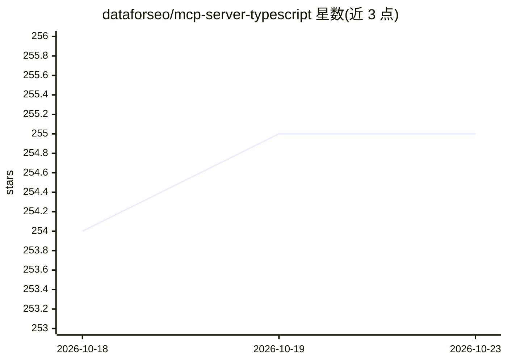

# dataforseo/mcp-server-typescript

⭐ 255 · TypeScript · Apache-2.0 · 推送 2026-10-02 · [GitHub](https://github.com/dataforseo/mcp-server-typescript) · [官网](http://dataforseo.com/) · 组织维护

**供 LLM agent 查阅 DataForSEO 文档并发起 API 请求的 MCP 服务器/CLI**

由 DataForSEO 维护的 v3 MCP 服务器与 CLI 二合一二进制：默认在 stdio 启动 MCP 服务器，可用 --mode http 切换 Streamable HTTP（默认端口 3000）。提供 docs_index、docs_list_sections、docs_search、api_request 四个工具，文档响应缓存 24 小时，api_request 默认走 .ai 路径。认证默认 HTTP 模式 OAuth 2.0，stdio/CLI 需 DATAFORSEO_LOGIN/PASSWORD 环境变量；另支持按 API 端点路径的返回字段裁剪配置，可构建为 Cloudflare Worker。前代 v2+ 服务器已弃用。

## 筛选速览

| 维度 | 判定 | 备注 |
|---|---|---|
| AI 角色 | `ai-ecosystem` | LLM/agent 周边工具 |
| 许可风险 | `permissive` | Apache-2.0 |
| 部署形态 | `library` | 以包/库形式分发 |
| 模型依赖 | — | README 未给出锁定关系 |
| 硬件要求 | — | 无带数字的原话,不猜 |
| 安装摩擦 | `low` | 无编译、无系统依赖或容器化 |
| 成熟度 | — | 结构信号不足 |

## 能力要点

- 单一二进制同时提供 MCP 服务器（stdio/HTTP）与 docs/request CLI
- HTTP 传输默认 OAuth 2.0，Protected Resource 元数据按 RFC 9728 暴露
- 文档索引/检索缓存 24 小时，api_request 默认使用 .ai 路径
- 按 API 端点路径配置返回字段裁剪，支持 Node 与 Cloudflare Worker 构建

## 适用场景

- 在 Cursor/Claude Desktop 等 MCP 客户端中让 agent 检索 DataForSEO API 文档
- 通过 MCP 或 CLI 发起带认证的 DataForSEO API 请求
- 裁剪 SERP/反链等接口的返回字段以精简 agent 上下文

## 场景标签

 · 领域:SEO 数据 API/MCP 工具

## 证据(README 行号)

> L5: MCP server and CLI for LLM agents to browse DataForSEO API documentation and make authenticated API requests. By def
> L110: ### MCP Tools
> L117: |`api_request`|API Request|Make an authenticated API request|

## 星数曲线

2026-10-18 254 → 2026-10-23 255（+1）

---
*卡片 v1 · prompt 1.4 · 生成 2026-10-22 · 置信度 high · 依据 README sha `e9d217e11576` · [字段定义](../../DATASET.md)*
