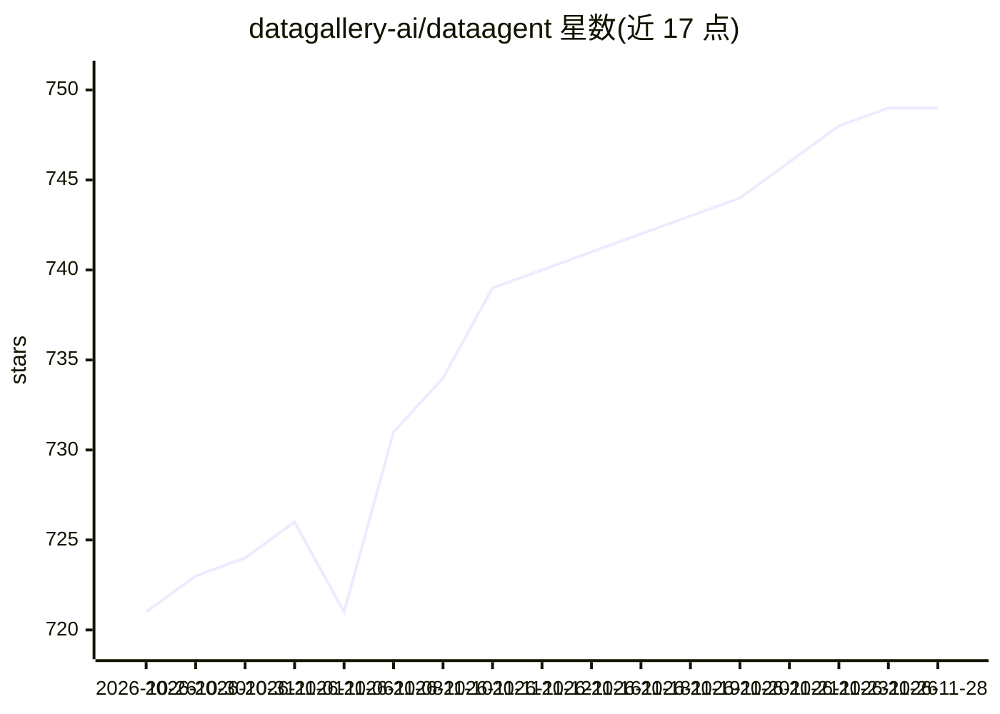

# datagallery-ai/dataagent

⭐ 749 · TypeScript · Apache-2.0 · 推送 2026-11-27 · [GitHub](https://github.com/datagallery-ai/dataagent) · [官网](https://datagallery-ai.github.io/dataagent/) · 组织维护 · 中文 README

**企业数据分析 AI agent 工作台：自然语言提问出结果**

DataFoundry/DataAgent 是一个开源数据分析 AI 工作台，将数据源、知识、工具与 agent 运行时整合到统一工作区。用户以自然语言提出问题，agent 调用服务器上配置的工具分析输入并生成文件，会话可恢复、产物可检索，日志与 trace 记录模型和工具调用。支持自托管部署、多模型配置、NL2SQL、本地文件目录输入；提供 Web 工作台与终端 TUI 两种界面，并通过 REST、AG-UI、A2A、Python SDK 对外集成。

## 筛选速览

| 维度 | 判定 | 备注 |
|---|---|---|
| AI 角色 | `ai-native` | 本体是模型或模型工具 |
| 许可风险 | `permissive` | Apache-2.0 |
| 部署形态 | `None` |  |
| 模型依赖 | — | README 未给出锁定关系 |
| 硬件要求 | — | 无带数字的原话,不猜 |
| 安装摩擦 | `low` | 无编译、无系统依赖或容器化 |
| 成熟度 | — | 结构信号不足 |

## 能力要点

- 自然语言发起数据分析，生成文件与会话可恢复
- 自托管部署，支持默认模型与按工具的多模型配置
- Web 工作台与终端 TUI 共享同一服务器与会话
- 提供 REST、AG-UI、A2A 与 Python SDK 集成接口

## 适用场景

- 用自然语言分析本地文件并保留产物
- 通过 NL2SQL 用自然语言查询数据库
- 在终端或 SSH 环境用 TUI 执行分析任务
- 把数据分析 agent 集成进自己的应用

## 场景标签

`数据分析` · 领域:效率与自动化

## 证据(README 行号)

> L3:  An enterprise-grade data agent
> L27: - **Self-hosted deployment and multi-model support.** Run DataAgent on your own machine or server. Configure the de
> L49: 1. **Define the task.** Ask a question in natural language using the inputs and tools configured on the server.

## 星数曲线

2026-10-26 721 → 2026-11-28 749（+28）

---
*卡片 v1 · prompt 1.4 · 生成 2026-11-28 · 置信度 high · 依据 README sha `65cd9e245388` · [字段定义](../../DATASET.md)*
