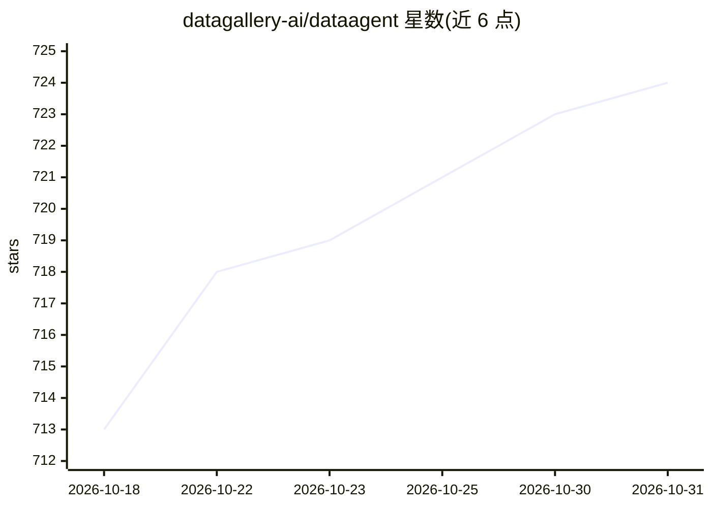

# datagallery-ai/dataagent

⭐ 724 · TypeScript · Apache-2.0 · 推送 2026-10-30 · [GitHub](https://github.com/datagallery-ai/dataagent) · [官网](https://datagallery-ai.github.io/dataagent/) · 组织维护 · 中文 README

**面向企业的开源 Data Agent 数据分析工作台**

自托管的 AI 数据分析工作台（DataFoundry），面向需要让 AI 查询企业数据库的团队：以自然语言提问，经语义对齐后在只读边界内执行多表多步分析，产出可复用的表、图表与报告。内置 28 种数据源类型（PostgreSQL、MySQL、Snowflake、BigQuery、ClickHouse、MongoDB 等），通过统一语义层管理 schema、指标定义与字段关系；默认只读 SQL、凭证隔离、字段脱敏，SQL 与事件流全量留痕可回放。模型侧支持任意 OpenAI 兼容 provider。提供 Ubuntu/Debian 一键部署脚本与手动 npm 两条路径，本版本不提供 Docker/Compose，不支持原生 Windows/macOS 一键部署（需手动 npm）。

## 筛选速览

| 维度 | 判定 | 备注 |
|---|---|---|
| AI 角色 | `ai-native` | 本体是模型或模型工具 |
| 许可风险 | `permissive` | Apache-2.0 |
| 部署形态 | `library` | 以包/库形式分发 |
| 模型依赖 | — | README 未给出锁定关系 |
| 硬件要求 | — | 无带数字的原话,不猜 |
| 安装摩擦 | `low` | 无编译、无系统依赖或容器化 |
| 成熟度 | — | 结构信号不足 |

## 能力要点

- 28 种数据源类型开箱即用（PostgreSQL/Snowflake/BigQuery/ClickHouse/MongoDB 等）
- 只读 SQL、凭证隔离、字段脱敏、行数与超时限制，SQL 与事件流全量持久化可回放
- 统一语义层：schema、指标定义、字段关系集中管理
- v0.2.0 支持可分支并发分析、证据引用追问、语义 Trace DAG

## 适用场景

- 在数据不出内网的前提下用自然语言做多表多步企业数据分析
- 让 GMV、留存等业务术语解析到经审核的表与字段定义
- 对每次分析的 SQL 与工具调用做审计与事后回放
- 通过 API / CopilotKit / AG-UI 将数据 Agent 运行时嵌入自有产品

## 场景标签

`数据分析` · 领域:效率与自动化

## 证据(README 行号)

> L3:  An enterprise-grade Data Agent workbench — it reads business definitions through unified semantics, runs complex mu
> L42: - 🏠 **Self-hosted deployment and multi-model support** — Run it inside your own boundary so data never leaves; on t
> L174: The **Web workbench** fits day-to-day analysis and demos, the **TUI** fits terminals and remote servers, and the *

## 星数曲线

2026-10-18 713 → 2026-10-31 724（+11）

---
*卡片 v1 · prompt 1.4 · 生成 2026-10-21 · 置信度 high · 依据 README sha `a89252f7578b` · [字段定义](../../DATASET.md)*
