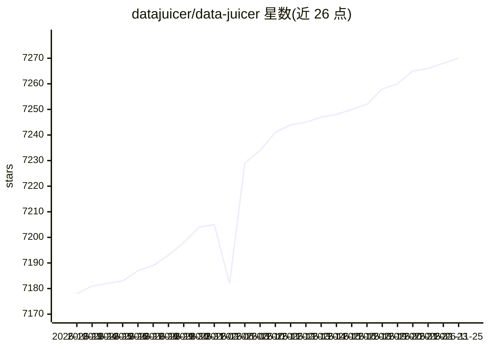

# datajuicer/data-juicer

⭐ 7,270 · Python · Apache-2.0 · 推送 2026-11-23 · [GitHub](https://github.com/datajuicer/data-juicer) · [官网](https://datajuicer.github.io/data-juicer/) · 组织维护 · 中文 README

**面向基础模型的数据处理系统：清洗/去重/合成/分析数据**

将数据处理视为可组合基础设施的数据处理系统：提供 200+ 算子覆盖文本、图像、音频、视频与多模态数据，通过可版本化的 YAML 配方组织清洗、过滤、去重、合成与分析流程；支持 Ray 分布式扩展到多节点集群，内置 OP 融合、自适应并行与 CUDA 加速，并附带追踪与调试能力。另提供自然语言数据精炼模型 Juicer。以 PyPI 包安装，提供 JupyterLab Playground 与 Docker 镜像。

## 筛选速览

| 维度 | 判定 | 备注 |
|---|---|---|
| AI 角色 | `ai-ecosystem` | LLM/agent 周边工具 |
| 许可风险 | `permissive` | Apache-2.0 |
| 部署形态 | `library` | 以包/库形式分发 |
| 模型依赖 | — | README 未给出锁定关系 |
| 硬件要求 | — | 无带数字的原话,不猜 |
| 安装摩擦 | `medium` | 含编译或系统依赖之一 |
| 成熟度 | — | 结构信号不足 |

## 能力要点

- 200+ 算子覆盖文本/图像/音频/视频/多模态数据
- YAML 配方式可复现流水线，支持版本化与热重载
- Ray 分布式：50 节点 2 小时处理 70B 样本，5TB 去重 2.8h
- 自然语言数据精炼模型 Juicer 可本地部署

## 适用场景

- 清洗与去重网页级预训练语料库
- 整理 agent 交互轨迹数据
- 为领域 RAG 索引准备数据
- 在集群上大规模处理多模态数据集

## 场景标签

`数据分析` `MLOps` · 领域:效率与自动化

## 证据(README 行号)

> L19: Data-Juicer (DJ) transforms raw data chaos into AI-ready intelligence. It treats data processing as *composable inf
> L21: Whether you're deduplicating web-scale pre-training corpora, curating agent interaction traces, or preparing domain
> L56: - **Foundation Models**: Pre-training, fine-tuning, RL, and evaluation-grade curation

## 星数曲线

2026-10-23 7,178 → 2026-11-25 7,270（+92）

---
*卡片 v1 · prompt 1.4 · 生成 2026-11-22 · 置信度 high · 依据 README sha `1911b2a8a8a2` · [字段定义](../../DATASET.md)*
