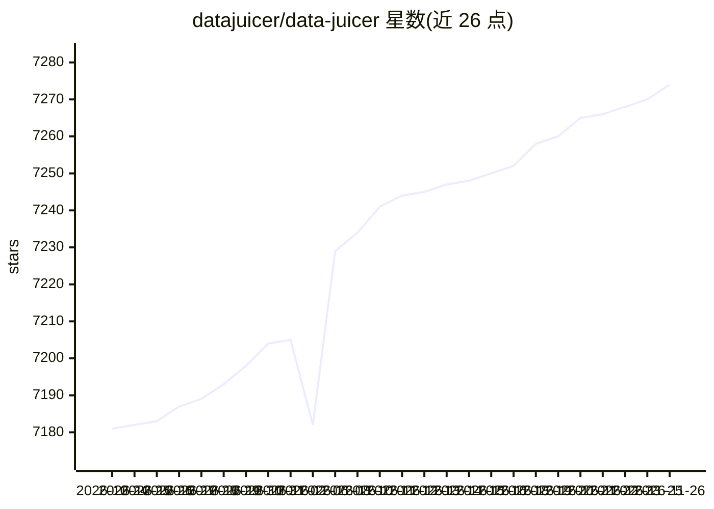

# datajuicer/data-juicer

⭐ 7,274 · Python · Apache-2.0 · 推送 2026-11-25 · [GitHub](https://github.com/datajuicer/data-juicer) · [官网](https://datajuicer.github.io/data-juicer/) · 组织维护 · 中文 README

**面向基础模型的数据处理系统：清洗/合成/分析数据**

Data-Juicer 将数据处理组织为可组合的基础设施，提供 200+ 覆盖文本、图像、音频、视频与多模态数据的算子，支持通过 YAML 配方构建可复现的清洗、去重、合成与分析流水线，应用于预训练语料、Agent 交互轨迹、RAG 索引等数据准备环节。提供 PyPI 安装、Python API 与 JupyterLab 教程，支持从单机到 Ray 集群扩缩，内置算子融合与自适应并行等优化，并包含自然语言数据精炼模型 Juicer。

## 筛选速览

| 维度 | 判定 | 备注 |
|---|---|---|
| AI 角色 | `ai-ecosystem` | LLM/agent 周边工具 |
| 许可风险 | `permissive` | Apache-2.0 |
| 部署形态 | `library` | 以包/库形式分发 |
| 模型依赖 | — | README 未给出锁定关系 |
| 硬件要求 | — | 无带数字的原话,不猜 |
| 安装摩擦 | `medium` | 含编译或系统依赖之一 |
| 成熟度 | — | 结构信号不足 |

## 能力要点

- 200+ 算子覆盖文本/图像/音频/视频/多模态数据
- Recipe-first：YAML 流水线可版本化、共享与 fork
- 支持 Ray 集群分布式处理与自动算子融合
- 内置自然语言数据精炼模型 Juicer

## 适用场景

- 清洗与去重网络规模的预训练语料
- 整理 Agent 交互轨迹数据并做质量过滤
- 为 RAG 构建语义分块与去重的索引数据
- 在大规模集群上并行处理多模态数据集

## 场景标签

`MLOps` · 领域:训练与推理

## 证据(README 行号)

> L19: Data-Juicer (DJ) transforms raw data chaos into AI-ready intelligence. It treats data processing as *composable inf
> L56: - **Foundation Models**: Pre-training, fine-tuning, RL, and evaluation-grade curation
> L61: - **Scale**: Process 70B samples in 2h on 50 Ray nodes (6400 cores)

## 星数曲线

2026-10-24 7,181 → 2026-11-26 7,274（+93）

---
*卡片 v1 · prompt 1.4 · 生成 2026-11-26 · 置信度 high · 依据 README sha `bd01b943af0d` · [字段定义](../../DATASET.md)*
