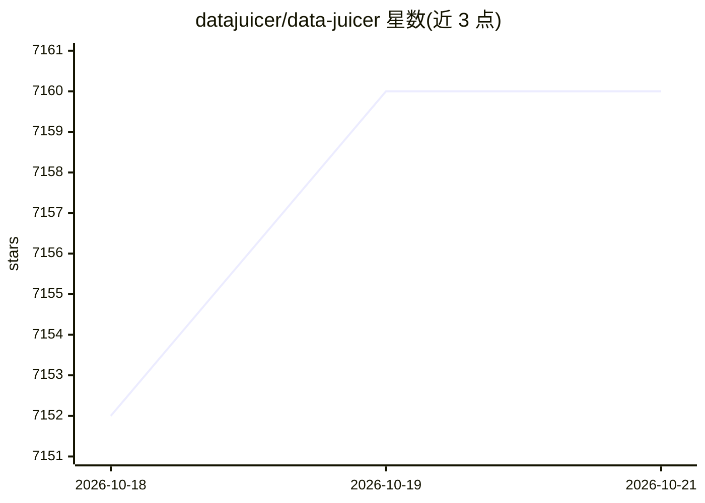

# datajuicer/data-juicer

⭐ 7,160 · Python · Apache-2.0 · 推送 2026-10-19 · [GitHub](https://github.com/datajuicer/data-juicer) · [官网](https://datajuicer.github.io/data-juicer/) · 组织维护 · 中文 README

**面向基础模型的数据处理系统：清洗/合成/分析训练数据**

Data-Juicer (DJ) 是面向基础模型全生命周期的数据处理系统，提供 200+ 覆盖文本、图像、音频、视频与多模态的算子，以可版本化 YAML 配方组成流水线，支持热重载与算子融合。场景涵盖预训练语料去重、微调与 RL 数据策展、agent 交互轨迹清洗、RAG 索引准备与数据分析。可从单机扩展到 Ray 千节点集群（声称 50 节点 2 小时处理 700 亿样本），提供 pip 安装、Docker、JupyterLab Playground 与 DJ Copilot；阿里云 PAI 已集成。附 Juicer 自然语言数据精炼模型。

## 筛选速览

| 维度 | 判定 | 备注 |
|---|---|---|
| AI 角色 | `ai-ecosystem` | LLM/agent 周边工具 |
| 许可风险 | `permissive` | Apache-2.0 |
| 部署形态 | `library` | 以包/库形式分发 |
| 模型依赖 | — | README 未给出锁定关系 |
| 硬件要求 | — | 无带数字的原话,不猜 |
| 安装摩擦 | `medium` | 含编译或系统依赖之一 |
| 成熟度 | — | 结构信号不足 |

## 能力要点

- 200+ 文本/图像/音频/视频/多模态算子，YAML 配方可版本化复用
- 覆盖预训练/微调/RL/评测、agent 轨迹与 RAG 数据策展
- Ray 分布式扩展、算子融合加速、CUDA 加速、内置可观测性
- 附 Juicer 自然语言数据精炼模型与 HuggingFace/ModelScope 试玩

## 适用场景

- 清洗与去重大规模预训练语料
- 准备微调、RL 或评测所需的高质量数据集
- 整理 agent 交互轨迹与 RAG 索引数据
- 构建领域数据流水线并版本化复用

## 场景标签

`MLOps` · 领域:训练与推理

## 证据(README 行号)

> L19: Data-Juicer (DJ) transforms raw data chaos into AI-ready intelligence. It treats data processing as *composable inf
> L21: Whether you're deduplicating web-scale pre-training corpora, curating agent interaction traces, or preparing domain
> L56: - **Foundation Models**: Pre-training, fine-tuning, RL, and evaluation-grade curation

## 星数曲线

2026-10-18 7,152 → 2026-10-21 7,160（+8）

---
*卡片 v1 · prompt 1.4 · 生成 2026-10-20 · 置信度 high · 依据 README sha `70cb113fc394` · [字段定义](../../DATASET.md)*
