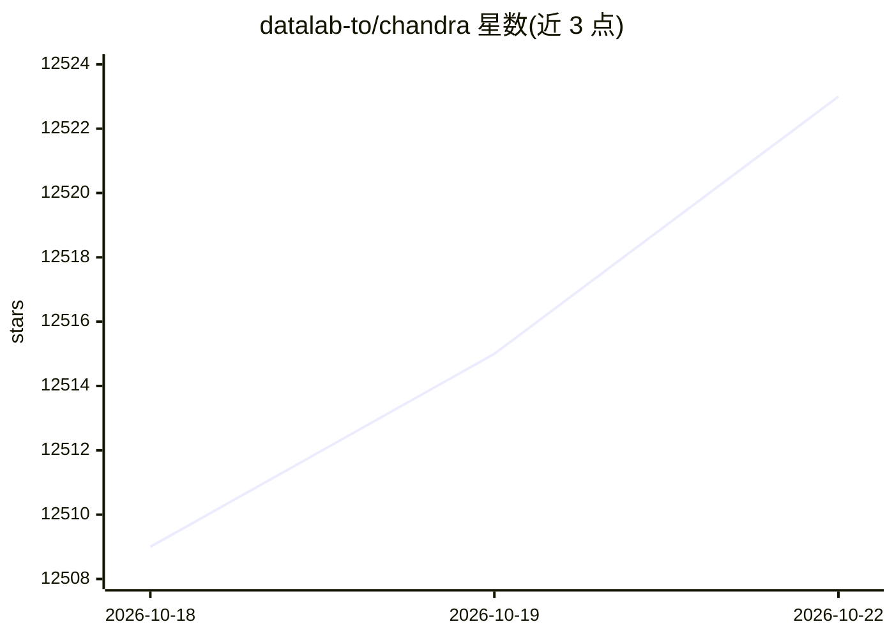

# datalab-to/chandra

⭐ 12,534 · Python · Apache-2.0 · 推送 2026-10-22 · [GitHub](https://github.com/datalab-to/chandra) · [官网](https://www.datalab.to) · 组织维护

**OCR 模型：将图像/PDF 转为保留版面的 Markdown/HTML/JSON**

Datalab 开发的文档智能 OCR 模型 Chandra 2，将图像和 PDF 转换为结构化的 HTML/Markdown/JSON 并保留布局信息，支持 90+ 语言、手写体、表格、数学公式与表单（含复选框）重建，可提取图像与图表并生成题注。提供两种推理模式：本地 HuggingFace 加载与远程 vLLM 服务，安装后通过 CLI、Streamlit 应用（chandra_app）或 vLLM 启动器（chandra_vllm，Docker 容器）使用。代码 Apache 2.0，模型权重采用修改版 OpenRAIL-M 许可，商业自托管需另行授权。

## 筛选速览

| 维度 | 判定 | 备注 |
|---|---|---|
| AI 角色 | `ai-native` | 本体是模型或模型工具 |
| 许可风险 | `permissive` | Apache-2.0 |
| 部署形态 | `library` | 以包/库形式分发 |
| 模型依赖 | local-ok | 支持本地模型 |
| 硬件要求 | — | 无带数字的原话,不猜 |
| 安装摩擦 | `low` | 无编译、无系统依赖或容器化 |
| 成熟度 | — | 结构信号不足 |

## 能力要点

- 图像/PDF 转 Markdown/HTML/JSON，保留完整布局信息
- 支持 90+ 语言、手写体、表格、数学公式与表单复选框重建
- 两种推理模式：本地 HuggingFace 与远程 vLLM 服务
- CLI 支持 PDF 页码范围、并行 worker、批量大小等选项

## 适用场景

- 把扫描文档或 PDF 转成可用的 Markdown/HTML 结构化文本
- 批量处理含表格、数学、多栏版面的文档
- 识别手写笔记与表单并保留勾选框等结构

## 场景标签

`OCR` `文档解析` · 领域:知识与检索

## 证据(README 行号)

> L19: Chandra OCR 2 is a state of the art OCR model that converts images and PDFs into structured HTML/Markdown/JSON whil
> L39: - Convert documents to markdown, html, or json with detailed layout information
> L45: - Two inference modes: local (HuggingFace) and remote (vLLM server)

## 星数曲线

2026-10-18 12,509 → 2026-10-22 12,523（+14）

---
*卡片 v1 · prompt 1.4 · 生成 2026-10-20 · 置信度 high · 依据 README sha `8256acf4be0e` · [字段定义](../../DATASET.md)*
