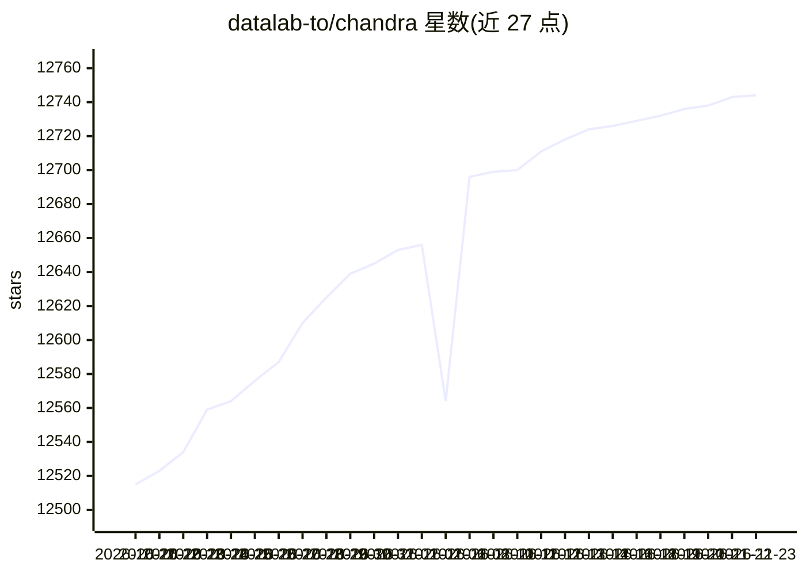

# datalab-to/chandra

⭐ 12,744 · Python · Apache-2.0 · 推送 2026-11-16 · [GitHub](https://github.com/datalab-to/chandra) · [官网](https://www.datalab.to) · 组织维护

**把图片/PDF 转为结构化 Markdown/HTML/JSON 的 OCR 模型**

Datalab 开源的 OCR 模型（Chandra OCR 2），将图像与 PDF 转换为带版式信息的 Markdown/HTML/JSON，输出布局块边界框与标签、提取图片与图表并生成说明。支持 90+ 语言、表格、数学公式、手写与表单复选框。提供两种推理方式：本地 HuggingFace 与远程 vLLM 服务器，附带 CLI、Python SDK、交互式 Web 查看器与 AI agent skill 安装。代码 Apache 2.0，模型权重采用修改版 OpenRAIL-M 许可，商业自托管需另行授权。

## 筛选速览

| 维度 | 判定 | 备注 |
|---|---|---|
| AI 角色 | `ai-native` | 本体是模型或模型工具 |
| 许可风险 | `permissive` | Apache-2.0 |
| 部署形态 | `library` | 以包/库形式分发 |
| 模型依赖 | local-ok | 支持本地模型 |
| 硬件要求 | — | 无带数字的原话,不猜 |
| 安装摩擦 | `low` | 无编译、无系统依赖或容器化 |
| 成熟度 | — | 结构信号不足 |

## 能力要点

- 图像/PDF 转 Markdown/HTML/JSON 并保留版式与布局块边界框
- 支持 90+ 语言、表格、数学、手写与含复选框的表单
- 两种推理模式：本地 HuggingFace 与远程 vLLM 服务器
- 提供 CLI、Python SDK、零依赖交互式 Web 查看器

## 适用场景

- 把扫描件和 PDF 批量转成结构化文本入库
- 识别包含复杂表格与数学公式的文档
- 转录手写笔记并保留版面结构

## 场景标签

`文档解析` `OCR` · 领域:知识与检索

## 证据(README 行号)

> L19: Chandra OCR 2 is a state of the art OCR model that converts images and PDFs into structured HTML/Markdown/JSON whil
> L41: - Convert documents to markdown, html, or json with detailed layout information
> L47: - Two inference modes: local (HuggingFace) and remote (vLLM server)

## 星数曲线

2026-10-21 12,515 → 2026-11-23 12,744（+229）

---
*卡片 v1 · prompt 1.4 · 生成 2026-11-23 · 置信度 high · 依据 README sha `4d3d11f271e7` · [字段定义](../../DATASET.md)*
