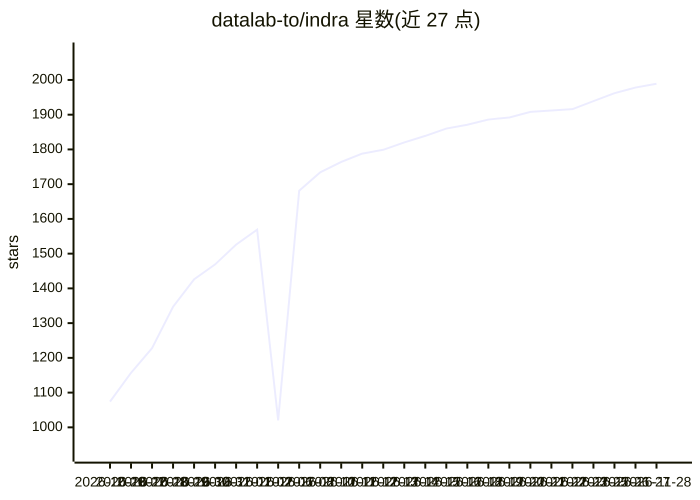

# datalab-to/indra

⭐ 1,989 · Python · Apache-2.0 · 推送 2026-11-24 · [GitHub](https://github.com/datalab-to/indra) · [官网](https://www.datalab.to) · 组织维护

**CPU 上运行的轻量 OCR 流水线：将 PDF 与图片转为 markdown/文本/JSON**

Indra OCR 是一个约 1M 参数的紧凑 OCR 流水线，基于 ONNX Runtime 运行于 CPU，无需 PyTorch 或 GPU。将 PDF 和图片转换为带框信息的 markdown、文本或 JSON，支持手写体、80+ 种语言及任意角度页面。提供 CLI 与 Python API，含本地 web 查看器、多进程批量转换、数学公式识别（LaTeX 输出）与数字 PDF 文本层读取。限制包括复杂表格、草书手写与退化扫描读取较弱。代码为 Apache 2.0，模型权重采用修改版 OpenRAIL-M 许可，商业使用需另行授权。

## 筛选速览

| 维度 | 判定 | 备注 |
|---|---|---|
| AI 角色 | `ai-native` | 本体是模型或模型工具 |
| 许可风险 | `permissive` | Apache-2.0 |
| 部署形态 | `library` | 以包/库形式分发 |
| 模型依赖 | — | README 未给出锁定关系 |
| 硬件要求 | `cpu-ok` | |
| 安装摩擦 | `low` | 无编译、无系统依赖或容器化 |
| 成熟度 | — | 结构信号不足 |

## 能力要点

- ONNX Runtime 运行于 CPU，无需 PyTorch 或 GPU
- 支持 80+ 种语言与手写识别，四种脚本识别器分工
- 输出含行/框/布局块/阅读顺序的结构化 JSON
- 附带本地 web 查看器，可对比 Tesseract 结果

## 适用场景

- 将扫描件和图片批量转为 markdown 或 JSON
- 提取含框和阅读顺序的版面结构数据
- 读取数字 PDF 文本层并对缺失部分做 OCR
- 多语言文档（含 CJK、RTL 文字）的文字识别

## 场景标签

`OCR` `文档解析` · 领域:知识与检索

## 证据(README 行号)

> L20: Indra OCR is a compact OCR pipeline that runs on CPU. It turns PDFs and images into markdown, text, or JSON with bo
> L23: - **CPU-first** - ONNX Runtime, no PyTorch or GPU required. Use multiple processes for batch conversion.

## 星数曲线

2026-10-26 1,074 → 2026-11-28 1,989（+915）

---
*卡片 v1 · prompt 1.4 · 生成 2026-11-26 · 置信度 high · 依据 README sha `889263da3977` · [字段定义](../../DATASET.md)*
