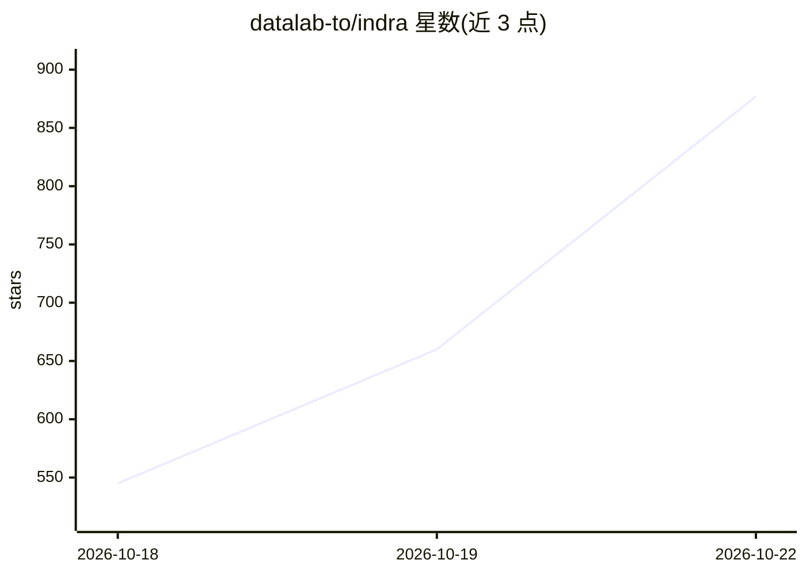

# datalab-to/indra

⭐ 877 · Python · Apache-2.0 · 推送 2026-10-20 · [GitHub](https://github.com/datalab-to/indra) · [官网](https://www.datalab.to) · 组织维护

**1M 参数级 CPU OCR 模型：把 PDF/图像转为 markdown/JSON**

Indra OCR 是一个约 1M 参数、运行在 CPU 上的 OCR 模型（全部默认模型共 7.3M 参数），将 PDF 与图像转换为 markdown、纯文本或带框线/置信度的 JSON。支持 80+ 语言（含中日韩、阿拉伯、天城体等）、手写体、任意倾斜角度扫描页与竖排文本；数字 PDF 优先读取文本层，缺失部分才 OCR。推理基于 ONNX Runtime，不依赖 PyTorch 与 GPU，首次运行从 Hugging Face 下载约 76MB 模型。提供 CLI、Python API 与本地网页查看器。README 明确列出局限：复杂表格、手写、退化扫描与未列文字系统读取较弱。代码 Apache 2.0，模型权重为修改版 OpenRAIL-M 许可并另设商业授权渠道。

## 筛选速览

| 维度 | 判定 | 备注 |
|---|---|---|
| AI 角色 | `ai-native` | 本体是模型或模型工具 |
| 许可风险 | `permissive` | Apache-2.0 |
| 部署形态 | `library` | 以包/库形式分发 |
| 模型依赖 | — | README 未给出锁定关系 |
| 硬件要求 | `cpu-ok` | |
| 安装摩擦 | `low` | 无编译、无系统依赖或容器化 |
| 成熟度 | — | 结构信号不足 |

## 能力要点

- ONNX Runtime 推理，无 PyTorch、无 GPU，默认模型约 76MB
- 四个识别器 + 行分类器覆盖 80+ 语言，含竖排 CJK 与 RTL 文字
- 数字 PDF 自动读取文本层，仅对缺失部分 OCR（auto 模式）
- 每行/每块输出框、标签与阅读顺序，含置信度与耗时

## 适用场景

- 批量把扫描件和 PDF 转成 markdown 或结构化 JSON
- 在无 GPU 的 CPU 服务器上做高吞吐文档数字化
- 查看 OCR 中间结果做调试（本地网页查看器）

## 场景标签

`OCR` `文档解析` · 领域:知识与检索

## 证据(README 行号)

> L20: Indra OCR is a 1M-parameter OCR model that runs on CPU. It turns PDFs and images into markdown, text, or JSON with 
> L29: - **Small** - ONNX Runtime, no PyTorch, no GPU

## 星数曲线

2026-10-18 545 → 2026-10-22 877（+332）

---
*卡片 v1 · prompt 1.4 · 生成 2026-10-21 · 置信度 high · 依据 README sha `ed976f00c1e9` · [字段定义](../../DATASET.md)*
