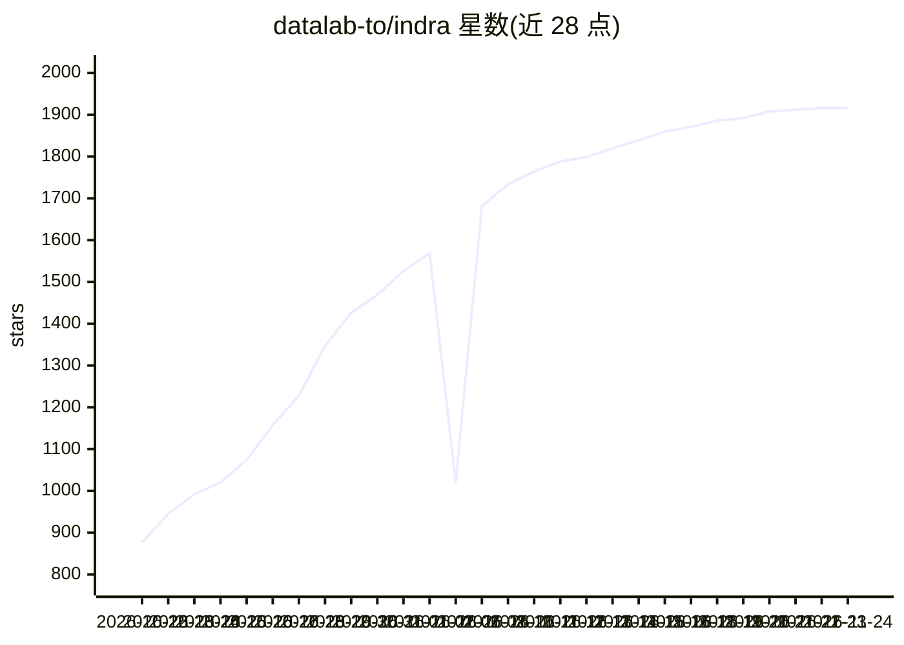

# datalab-to/indra

⭐ 1,939 · Python · Apache-2.0 · 推送 2026-11-04 · [GitHub](https://github.com/datalab-to/indra) · [官网](https://www.datalab.to) · 组织维护

**给开发者的 1M 参数 CPU 端 OCR 模型：把 PDF/图像转成 markdown/JSON**

Indra OCR 是一个约 1M 参数（主识别器约 1.25M，默认模型合计 7.3M）的 OCR 模型，基于 ONNX Runtime 运行，不依赖 PyTorch 和 GPU。输入 PDF 与图像，输出 markdown、text 或带框线、版块标签与阅读顺序的 JSON，支持 80+ 语言、手写、任意角度扫描页与数字 PDF 文本层读取。以 Python 包与 CLI 提供，附带本地 web viewer 对比查看结果。限制包括复杂表格、手写、退化扫描读取效果不佳，部分重音拉丁语言可能写错变音符号。

## 筛选速览

| 维度 | 判定 | 备注 |
|---|---|---|
| AI 角色 | `ai-native` | 本体是模型或模型工具 |
| 许可风险 | `permissive` | Apache-2.0 |
| 部署形态 | `library` | 以包/库形式分发 |
| 模型依赖 | — | README 未给出锁定关系 |
| 硬件要求 | `cpu-ok` | |
| 安装摩擦 | `low` | 无编译、无系统依赖或容器化 |
| 成熟度 | — | 结构信号不足 |

## 能力要点

- 1M 参数模型在 CPU 上运行（32 核约 44 页/s），无 PyTorch、无 GPU
- 支持 80+ 语言，含 CJK、阿拉伯语等 RTL、天城文等 Indic 文字
- 输出含行框、版块标签与阅读顺序的 JSON/markdown/text
- 支持垂直排版中文/日文与加密 PDF 密码参数

## 适用场景

- 把扫描 PDF 和图片批量转成 markdown 存档
- 对文档图片提取带坐标与阅读顺序的结构化 JSON
- 本地 CPU 环境处理多语言（中/日/韩/阿拉伯语）OCR
- 在内存中直接对 numpy 数组图像做识别

## 场景标签

`OCR` `文档解析` · 领域:知识与检索

## 证据(README 行号)

> L20: Indra OCR is a 1M-parameter OCR model that runs on CPU. It turns PDFs and images into markdown, text, or JSON with 
> L79: Python 3.10 or newer, tested on Linux (x86_64 and aarch64, Python 3.10 to 3.13) and macOS (Apple silicon). It insta

## 星数曲线

2026-10-22 877 → 2026-11-24 1,916（+1,039）

---
*卡片 v1 · prompt 1.4 · 生成 2026-11-23 · 置信度 high · 依据 README sha `fa4f173c5b0a` · [字段定义](../../DATASET.md)*
