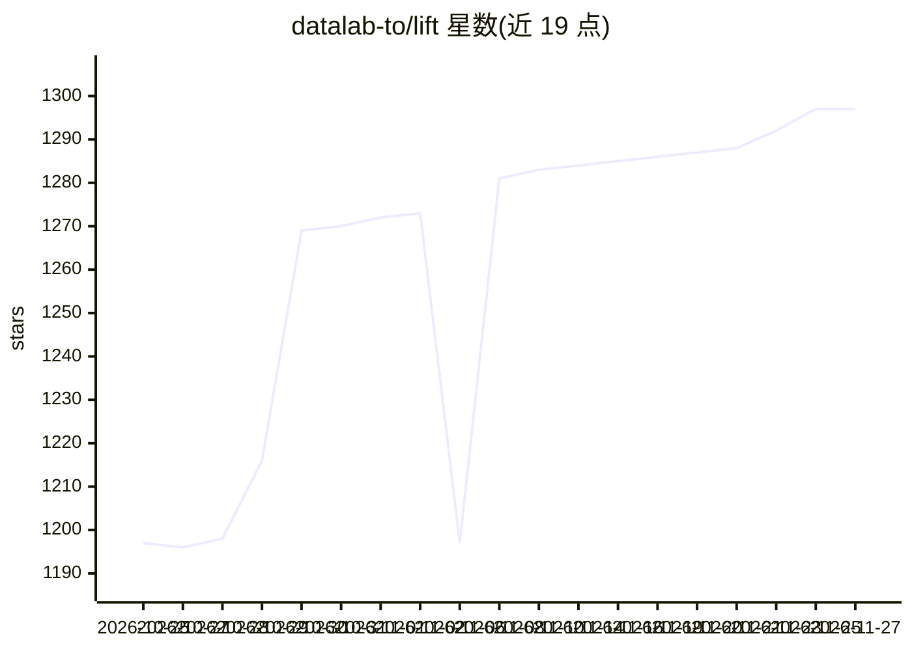

# datalab-to/lift

⭐ 1,297 · Python · Apache-2.0 · 推送 2026-10-22 · [GitHub](https://github.com/datalab-to/lift) · [官网](https://www.datalab.to) · 组织维护

**从 PDF/图像按 JSON Schema 提取结构化数据的 9B 视觉模型**

lift 是 Datalab 开源的 9B 视觉语言模型工具，接受任意 JSON Schema 作为输入，从 PDF 与图像中提取结构化 JSON；schema 约束解码保证输出格式合法，支持跨页字段与多页文档单次处理。提供本地 HuggingFace 推理与远程 vLLM 服务两种模式、CLI 与 Python API，附 Streamlit 编写的 Schema Studio 建模测试应用。代码 Apache 2.0，模型权重采用修改版 OpenRAIL-M 许可，商业自托管需另行授权。

## 筛选速览

| 维度 | 判定 | 备注 |
|---|---|---|
| AI 角色 | `ai-native` | 本体是模型或模型工具 |
| 许可风险 | `permissive` | Apache-2.0 |
| 部署形态 | `library` | 以包/库形式分发 |
| 模型依赖 | local-ok | 支持本地模型 |
| 硬件要求 | — | 无带数字的原话,不猜 |
| 安装摩擦 | `low` | 无编译、无系统依赖或容器化 |
| 成熟度 | — | 结构信号不足 |

## 能力要点

- 传入任意 JSON Schema 即可提取，schema 约束解码保证输出合法
- 本地 HuggingFace 与远程 vLLM 两种推理模式
- CLI 与 Python API，支持单文件与整个目录批处理
- Schema Studio（Streamlit）构建、保存与测试 schema

## 适用场景

- 把发票等文档批量转成符合 schema 的 JSON 数据
- 多页文档中跨页字段的一次性提取
- 构建可被 agent 消费的文档数据管道

## 场景标签

`文档解析` · 领域:知识与检索

## 证据(README 行号)

> L19: lift extracts structured JSON from PDFs and images by passing a schema. It's a 9B vision model that returns a JSON 
> L38: - Extract structured data from documents

## 星数曲线

2026-10-25 1,197 → 2026-11-27 1,297（+100）

---
*卡片 v1 · prompt 1.4 · 生成 2026-11-23 · 置信度 high · 依据 README sha `a93ee1b9252a` · [字段定义](../../DATASET.md)*
