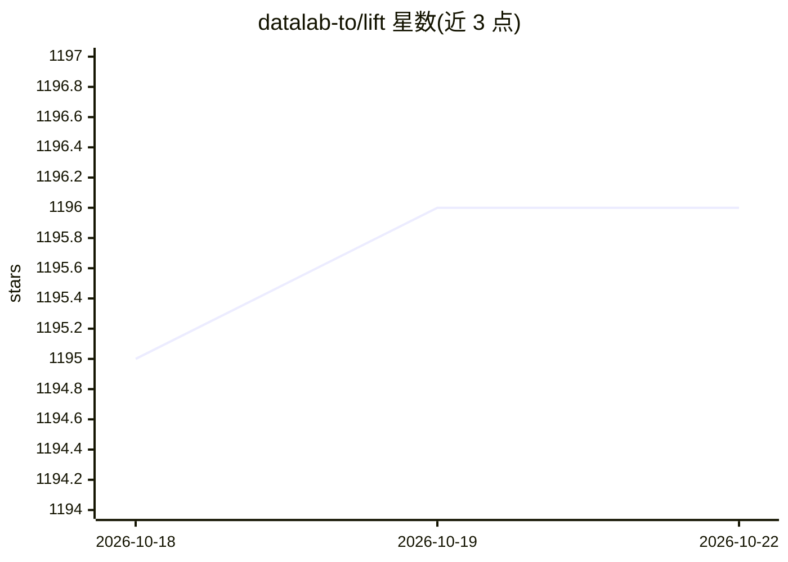

# datalab-to/lift

⭐ 1,196 · Python · Apache-2.0 · 推送 2026-10-05 · [GitHub](https://github.com/datalab-to/lift) · [官网](https://www.datalab.to) · 组织维护

**9B 视觉模型：按 JSON Schema 从 PDF/图片抽取结构化数据**

lift 是一个 9B 参数的视觉模型及配套 Python 包，传入任意 JSON Schema 后从 PDF 和图像文档中抽取结构化数据，通过 schema 约束解码保证输出为符合 Schema 的合法 JSON；支持多页文档单次抽取（含跨页值）。提供本地（HuggingFace 加载权重）与远程（vLLM 服务器）两种推理模式，附 CLI（单文件/内联 Schema/目录批量）与 Schema Studio 交互式构建工具。限制：Schema 不支持 enum/anyOf/$ref 等；商业自托管需另行许可，模型权重采用修改版 OpenRAIL-M 许可。

## 筛选速览

| 维度 | 判定 | 备注 |
|---|---|---|
| AI 角色 | `ai-native` | 本体是模型或模型工具 |
| 许可风险 | `permissive` | Apache-2.0 |
| 部署形态 | `library` | 以包/库形式分发 |
| 模型依赖 | local-ok | 支持本地模型 |
| 硬件要求 | — | 无带数字的原话,不猜 |
| 安装摩擦 | `low` | 无编译、无系统依赖或容器化 |
| 成熟度 | — | 结构信号不足 |

## 能力要点

- 9B 视觉模型 + schema 约束解码，输出保证符合给定 JSON Schema
- 多页文档单次抽取，支持跨页值
- 两种推理模式：本地 HuggingFace 与远程 vLLM 服务器
- CLI 支持单文件、内联 Schema 与整目录批量处理，另有 Streamlit 版 Schema Studio

## 适用场景

- 从发票、报告等多页 PDF 中按自定义 Schema 抽取字段
- 批量处理文档目录并输出结构化 JSON
- 在 Schema Studio 中针对自有文档构建和测试抽取 Schema

## 场景标签

`文档解析` · 领域:知识与检索

## 证据(README 行号)

> L19: lift extracts structured JSON from PDFs and images by passing a schema. It's a 9B vision model that returns a JSON 
> L39: - Two inference modes: local (HuggingFace) and remote (vLLM server)

## 星数曲线

2026-10-18 1,195 → 2026-10-22 1,196（+1）

---
*卡片 v1 · prompt 1.4 · 生成 2026-10-21 · 置信度 high · 依据 README sha `78b19f2ea4f7` · [字段定义](../../DATASET.md)*
