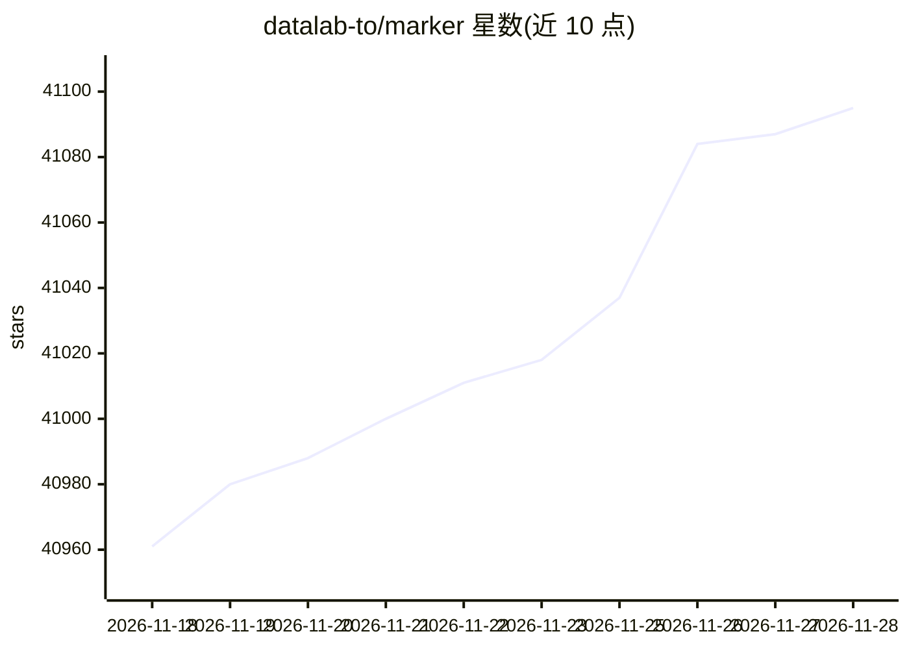

# datalab-to/marker

⭐ 41,095 · Python · Apache-2.0 · 推送 2026-11-27 · [GitHub](https://github.com/datalab-to/marker) · [官网](https://www.datalab.to) · 组织维护

**把 PDF/文档转为 Markdown/JSON/HTML 的解析工具**

Marker 是一个文档转换工具，将 PDF、图片、PPTX、DOCX、XLSX、HTML、EPUB 转为 Markdown、JSON、chunks 和 HTML，支持表格、公式、行内数学、链接与代码块的格式化，并可提取图片、去除页眉页脚。提供四种运行模式（no_ocr/fast/balanced/vllm），按硬件自动选择默认模式，支持 GPU、CPU 和 MPS。可通过 --use_llm 标志调用外部 LLM 提升转换效果。代码采用 Apache 2.0，模型权重采用修改版许可（研究/个人/小规模初创免费，商业使用需付费）。

## 筛选速览

| 维度 | 判定 | 备注 |
|---|---|---|
| AI 角色 | `ai-native` | 本体是模型或模型工具 |
| 许可风险 | `permissive` | Apache-2.0 |
| 部署形态 | `library` | 以包/库形式分发 |
| 模型依赖 | local-ok | 支持本地模型 |
| 硬件要求 | `cpu-ok` | |
| 安装摩擦 | `low` | 无编译、无系统依赖或容器化 |
| 成熟度 | — | 结构信号不足 |

## 能力要点

- 支持 PDF、图片、PPTX、DOCX、XLSX、HTML、EPUB 多格式输入，输出 Markdown/JSON/HTML/chunks
- 四种模式：no_ocr、fast（CPU/MPS）、balanced（GPU 默认）、vllm（全页 VLM OCR）
- 可通过 --use_llm 搭配 Gemini、Claude、OpenAI-compatible、Azure、Vertex、OpenRouter、Ollama 等模型
- 内置交互式 Web 查看器，可逐页检查布局块与渲染结果

## 适用场景

- 将论文、教材等 PDF 转成 Markdown 供后续处理
- 批量解析含表格与公式的文档并输出 JSON
- 在无 GPU 的环境用 CPU 模式做文本层提取与版面分析

## 场景标签

`文档解析` `OCR` · 领域:知识与检索

## 证据(README 行号)

> L19: Marker converts documents to markdown, JSON, chunks, and HTML quickly and accurately.
> L21: - Converts PDF, image, PPTX, DOCX, XLSX, HTML, EPUB files in all languages
> L27: - Works on GPU, CPU, or MPS

## 星数曲线

2026-11-18 40,961 → 2026-11-28 41,095（+134）

---
*卡片 v1 · prompt 1.4 · 生成 2026-11-28 · 置信度 high · 依据 README sha `431f4d2d73fc` · [字段定义](../../DATASET.md)*
