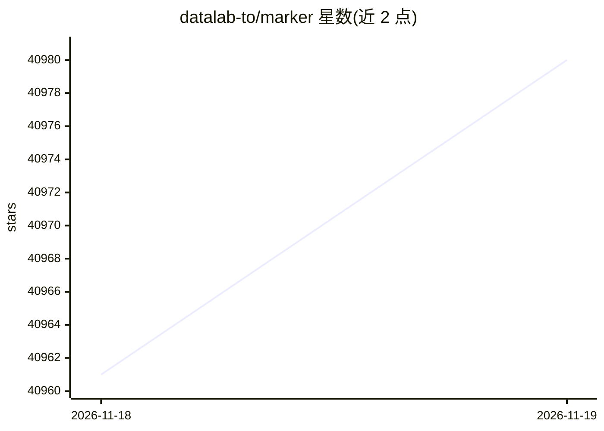

# datalab-to/marker

⭐ 40,980 · Python · Apache-2.0 · 推送 2026-11-18 · [GitHub](https://github.com/datalab-to/marker) · [官网](https://www.datalab.to) · 组织维护

**将 PDF/Office/EPUB 等文档转为 Markdown/JSON 的深度学习解析工具**

基于深度学习模型的文档转换库：读取 PDF、图像、PPTX、DOCX、XLSX、HTML、EPUB，生成 Markdown、JSON、HTML 与 chunks，处理表格、公式、内联数学与代码块并提取图片。提供四种模式（no_ocr/fast/balanced/vllm），balanced 模式用智能路由在 CPU 处理干净页面、将公式/复杂表格/CJK/扫描页交给 Surya VLM；GPU 模式通过自动拉起的 vLLM 或 llama.cpp 推理服务运行。可选 --use_llm 接入 Gemini/Claude/OpenAI 兼容/Ollama 等提升精度。代码 Apache 2.0，模型权重采用修改版 Open Rail-M 许可（商业使用超出免费范围需付费）。

## 筛选速览

| 维度 | 判定 | 备注 |
|---|---|---|
| AI 角色 | `ai-native` | 本体是模型或模型工具 |
| 许可风险 | `permissive` | Apache-2.0 |
| 部署形态 | `library` | 以包/库形式分发 |
| 模型依赖 | local-ok | 支持本地模型 |
| 硬件要求 | — | 无带数字的原话,不猜 |
| 安装摩擦 | `low` | 无编译、无系统依赖或容器化 |
| 成熟度 | — | 结构信号不足 |

## 能力要点

- 支持 PDF/图像/PPTX/DOCX/XLSX/HTML/EPUB 转 Markdown/JSON/HTML/chunks
- 四种模式覆盖 GPU 与纯 CPU 场景（fast 模式纯进程内 CPU 运行）
- balanced 模式智能路由：干净页面留 CPU，复杂页面调用 Surya VLM
- 可选 --use_llm 接入 Gemini/Claude/OpenAI 兼容/Azure/Vertex/OpenRouter/Ollama 提升精度
- 内置交互式 Web 查看器（marker_gui）

## 适用场景

- 把论文、教科书等 PDF 转成 Markdown 供 RAG 知识库使用
- 批量提取 PDF 中的表格、公式与图片
- 在无 GPU 的笔记本或 CI 环境中做文档解析
- 通过 --stdout 管道在 shell 或 AI agent 中直接消费转换结果

## 场景标签

`文档解析` · 领域:知识与检索

## 证据(README 行号)

> L19: Marker converts documents to markdown, JSON, chunks, and HTML quickly and accurately.
> L21: - Converts PDF, image, PPTX, DOCX, XLSX, HTML, EPUB files in all languages
> L118:  - `balanced` (default on **GPU**) uses smart routing: `pdftext` + Indra ONNX layout on clean Latin prose pages, a

## 星数曲线

2026-11-18 40,961 → 2026-11-19 40,980（+19）

---
*卡片 v1 · prompt 1.4 · 生成 2026-11-18 · 置信度 high · 依据 README sha `36672de3e825` · [字段定义](../../DATASET.md)*
