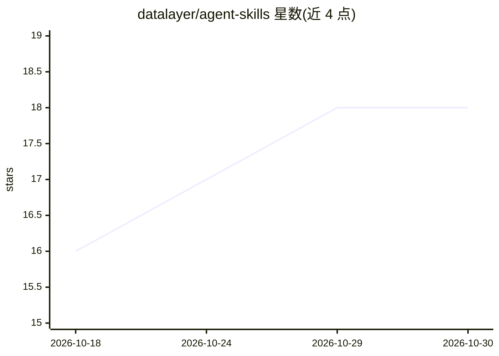

# datalayer/agent-skills

⭐ 18 · Python · BSD-3-Clause · 推送 2026-10-18 · [GitHub](https://github.com/datalayer/agent-skills) · [官网](https://agent-skills.datalayer.tech) · 组织维护

**为 AI agent 创建、管理与执行可复用技能的 Python 库**

面向 AI agent 开发者的技能管理库：技能即 Python 文件或带 YAML frontmatter 的 SKILL.md，agent 可通过列出目录、写文件的方式发现、创建并执行技能，并支持技能间相互组合。提供 SkillDirectory / AgentSkillsToolset 等 API，支持基于路径与基于模块的两种技能加载，可配合 Pydantic AI 与 code-sandboxes 沙箱（可配置 Kaggle GPU）运行；另有可选的 SkillManager 与 MCP server 用于数据库存储与技能注册。以 pip 包分发，BSD 3-Clause 许可。

## 筛选速览

| 维度 | 判定 | 备注 |
|---|---|---|
| AI 角色 | `ai-ecosystem` | LLM/agent 周边工具 |
| 许可风险 | `permissive` | BSD-3-Clause |
| 部署形态 | `library` | 以包/库形式分发 |
| 模型依赖 | — | README 未给出锁定关系 |
| 硬件要求 | — | 无带数字的原话,不猜 |
| 安装摩擦 | `low` | 无编译、无系统依赖或容器化 |
| 成熟度 | — | 结构信号不足 |

## 能力要点

- 技能即 Python 文件，agent 可自主创建、发现、执行与组合技能
- SKILL.md 格式含 YAML frontmatter 与工具访问策略（allow/deny）
- 提供 Pydantic AI AgentSkillsToolset 集成与 SandboxExecutor 沙箱执行
- 可选 SkillManager 与 MCP server 支持数据库存储与技能注册

## 适用场景

- 让 agent 在运行中积累并复用自己编写的工具组合
- 以目录或 pip 包形式分发和加载 agent 技能
- 在沙箱（含 Kaggle GPU）中执行技能脚本

## 场景标签

`Agent 框架` · 领域:Agent 开发

## 证据(README 行号)

> L9: **Reusable Agent Skills**: Create, manage, and execute reusable code-based tool compositions for AI agents.
> L15: Agent Skills provides a simple and powerful way for AI agents to build their own toolbox. Skills are Python files t

## 星数曲线

2026-10-18 16 → 2026-10-30 18（+2）

---
*卡片 v1 · prompt 1.4 · 生成 2026-10-29 · 置信度 high · 依据 README sha `006bce2b2091` · [字段定义](../../DATASET.md)*
