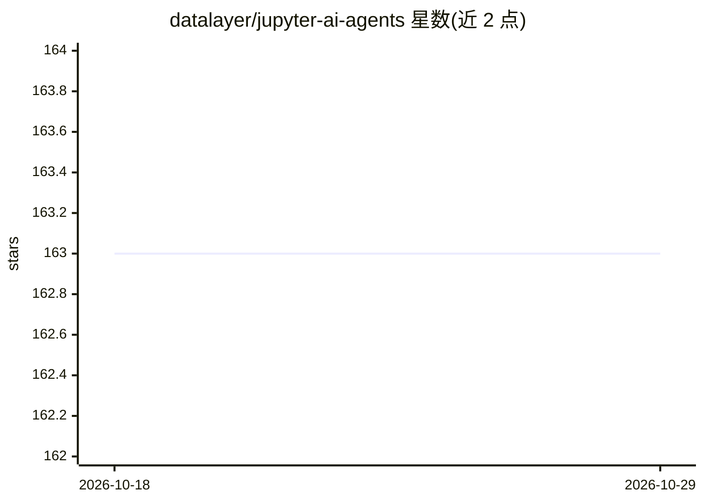

# datalayer/jupyter-ai-agents

⭐ 163 · Jupyter Notebook · BSD-3-Clause · 推送 2026-10-18 · [GitHub](https://github.com/datalayer/jupyter-ai-agents) · [官网](https://jupyter-ai-agents.datalayer.tech) · 组织维护

**JupyterLab 的 AI Agent：对话操控笔记本并执行代码**

面向 JupyterLab 用户的 AI Agent 工具：提供聊天界面与 CLI/REPL 两种使用方式。Agent 基于 Pydantic AI 编排、通过 MCP 工具与 Jupyter MCP Server 交互，可读写笔记本内容、增改单元格、执行代码、安装包，并支持 explain-error 错误分析与按指令生成代码。聊天界面默认支持 Anthropic Claude Sonnet 4.0；CLI 支持 openai、anthropic、azure-openai、github-copilot、google、bedrock、groq、mistral、cohere 等多种模型提供方。Agent 作用于整个 Notebook 而非仅单元格层级，可通过 RTC 与 Jupyter 服务端分离运行。安装需执行额外的 pycrdt 卸载与 datalayer_pycrdt 固定版本安装步骤。

## 筛选速览

| 维度 | 判定 | 备注 |
|---|---|---|
| AI 角色 | `ai-native` | 本体是模型或模型工具 |
| 许可风险 | `permissive` | BSD-3-Clause |
| 部署形态 | `library` | 以包/库形式分发 |
| 模型依赖 | locked-api |  |
| 硬件要求 | — | 无带数字的原话,不猜 |
| 安装摩擦 | `low` | 无编译、无系统依赖或容器化 |
| 成熟度 | — | 结构信号不足 |

## 能力要点

- JupyterLab 内聊天界面，Agent 通过 MCP 工具操作笔记本
- CLI 提供 prompt、explain-error 与交互式 REPL 模式
- 支持 9 种模型提供方（openai/anthropic/azure-openai/github-copilot/google/bedrock/groq/mistral/cohere）
- Agent 作用于整个 Notebook，经 RTC 可与 Jupyter 服务端分离运行

## 适用场景

- 在 JupyterLab 里用对话让 AI 创建、修改并执行笔记本单元格
- 命令行批量执行笔记本自动化操作
- 让 AI 分析并修复笔记本中的报错单元格

## 场景标签

`编码 Agent` · 领域:编码与开发

## 证据(README 行号)

> L10: 🪐 ✨ AI Agents for JupyterLab with 🛠️ MCP tools - Chat interface for intelligent notebook interaction, code executio
> L22: By default, the Jupyter MCP Server is started as a Jupyter server extension, providing access to all Jupyter MCP se
> L270: Jupyter AI Agents empowers **AI** models to **interact** with and **modify Jupyter Notebooks**. The agent is equip

## 星数曲线

2026-10-18 163 → 2026-10-29 163（+0）

---
*卡片 v1 · prompt 1.4 · 生成 2026-10-22 · 置信度 high · 依据 README sha `4a40834deb8c` · [字段定义](../../DATASET.md)*
