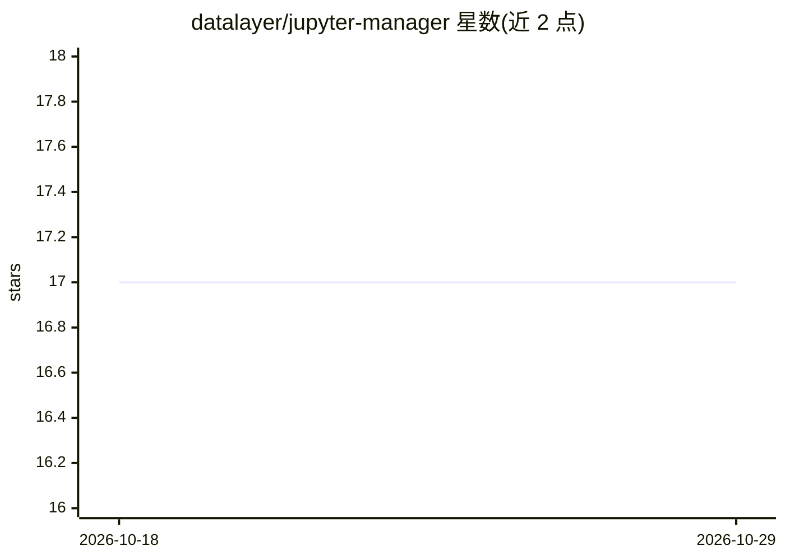

# datalayer/jupyter-manager

⭐ 17 · TypeScript · NOASSERTION · 推送 2026-04-30 · [GitHub](https://github.com/datalayer/jupyter-manager) · [官网](https://jupyter-manager.datalayer.tech) · 组织维护

**Jupyter 平台的可视化管理用户界面**

Datalayer 维护的 Jupyter 平台管理界面：以可视化方式替代 shell 脚本与配置文件，支持对 Jupyter 平台进行 configure、monitor 和 operate 操作。部署形态有两种：作为 JupyterLab 扩展管理该 Jupyter Server 实例上的本地扩展，或作为服务部署在任意 JupyterHub 上并通过 JupyterHub REST API 工作。README 仅给出简要部署说明与贡献指引，未提供安装命令细节。

## 筛选速览

| 维度 | 判定 | 备注 |
|---|---|---|
| AI 角色 | `ai-enhanced` | 去掉 AI 部分产品仍成立 |
| 许可风险 | `none` | NOASSERTION |
| 部署形态 | `None` |  |
| 模型依赖 | — | README 未给出锁定关系 |
| 硬件要求 | — | 无带数字的原话,不猜 |
| 安装摩擦 | `low` | 无编译、无系统依赖或容器化 |
| 成熟度 | — | 结构信号不足 |

## 能力要点

- 可视化配置、监控与操作 Jupyter 平台
- 可作为 JupyterLab 扩展部署，管理本地扩展
- 可作为服务部署于 JupyterHub，通过其 REST API 工作

## 适用场景

- 希望以界面方式而非配置文件管理 Jupyter 平台
- 在 JupyterHub 集群上统一监控与运维
- 管理 Jupyter Server 实例上的扩展

## 场景标签

`MLOps` · 领域:训练与推理

## 证据(README 行号)

> L9: Jupyter Manager is a user interface to manage the Jupyter platform in a more visual way instead of relying to shell 
> L19: - As a JupyterLab extension, in that case it allows you the manage the local extensions deployed on that Jupyter Se
> L20: - As a service on any JupyterHub, in that case it uses the JupyterHub REST API (see the Swagger definition).

## 星数曲线

2026-10-18 17 → 2026-10-29 17（+0）

---
*卡片 v1 · prompt 1.4 · 生成 2026-10-29 · 置信度 low · 依据 README sha `b20ebc3e491a` · [字段定义](../../DATASET.md)*
